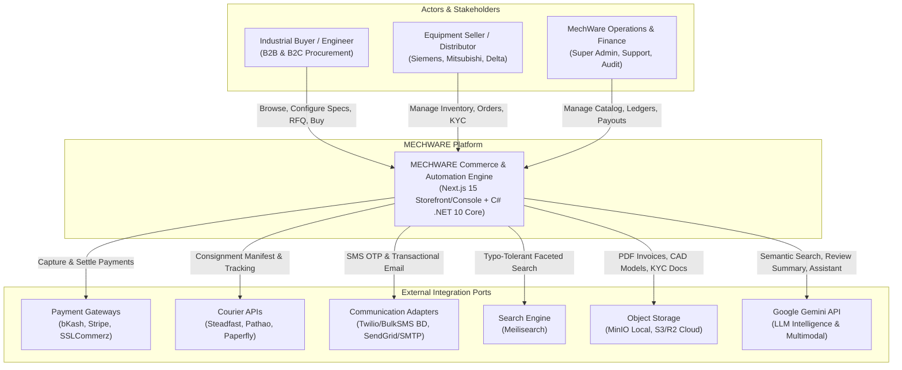
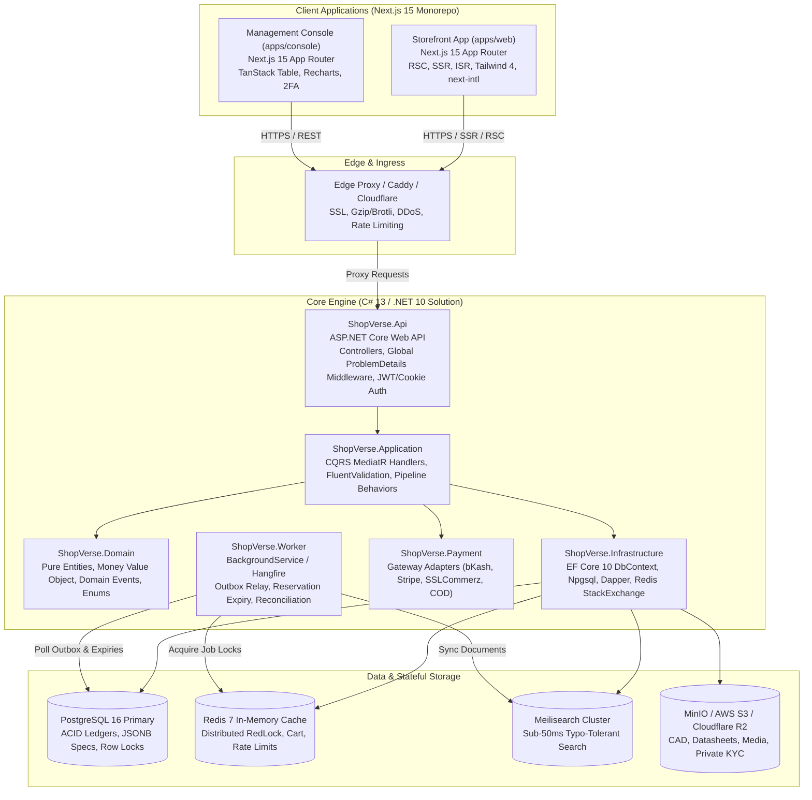
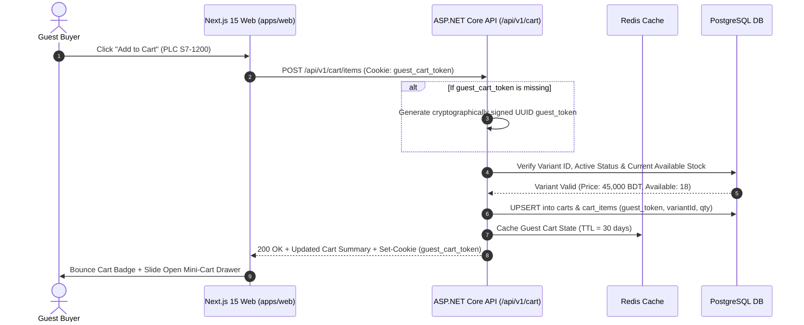
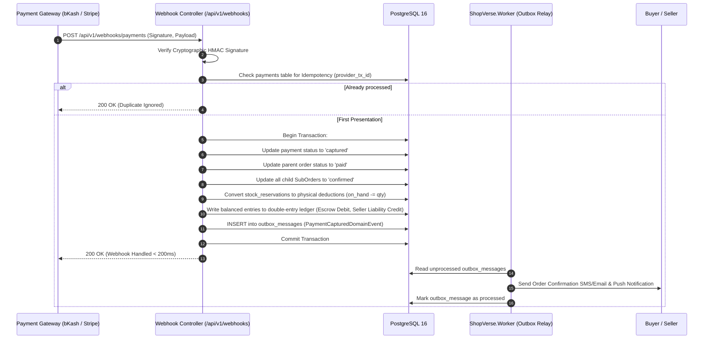
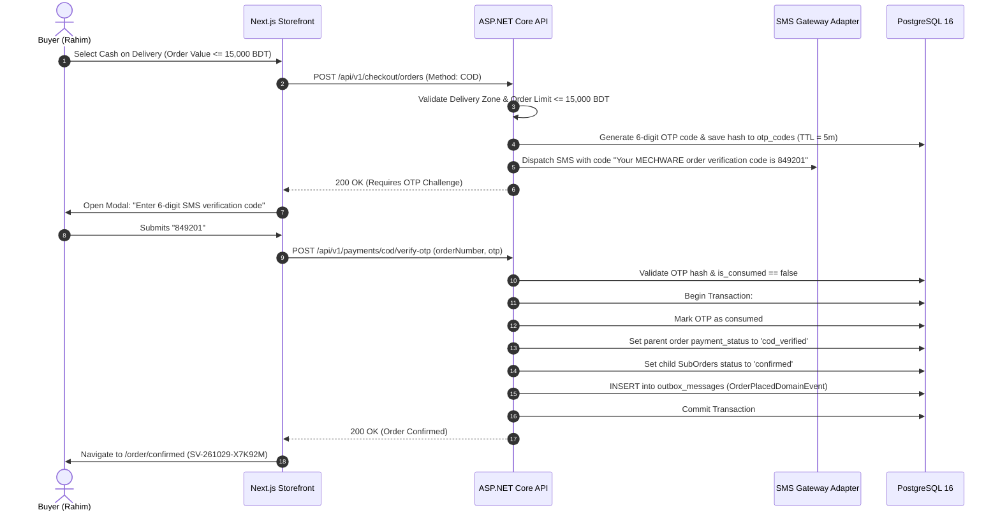
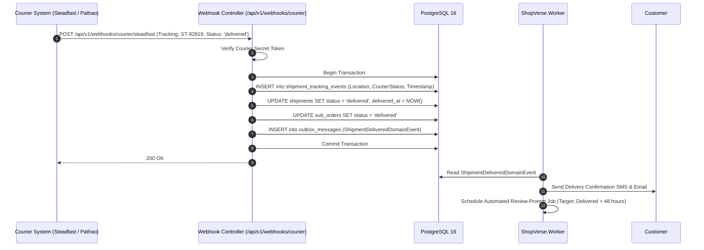
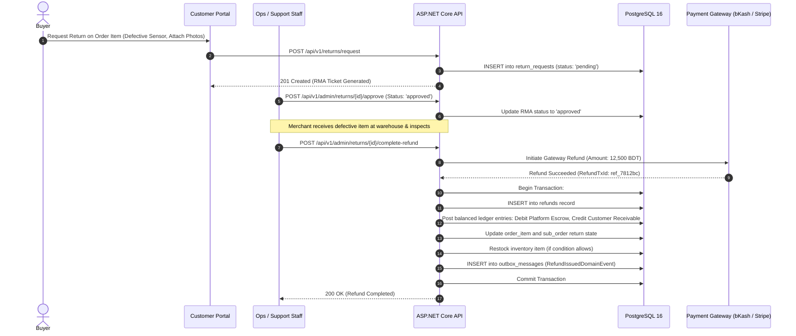
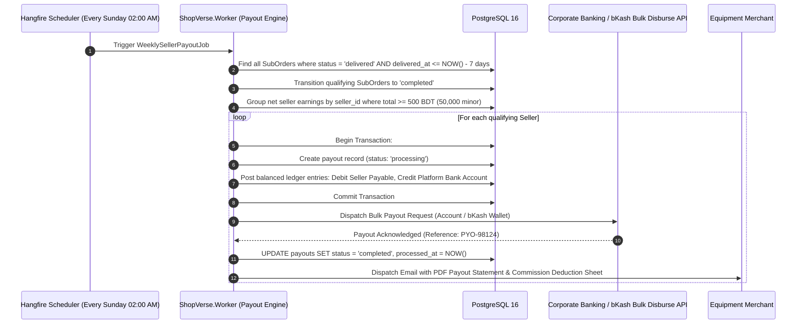
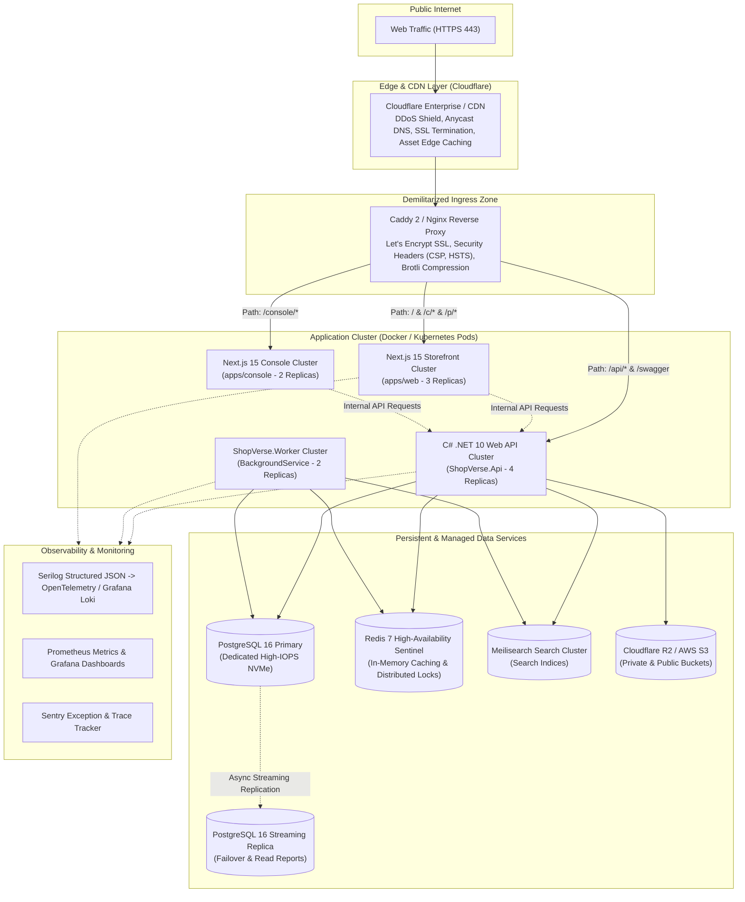

# SYSTEM ARCHITECTURE SPECIFICATION — MECHWARE

> **Stack:** C# 13 / .NET 10 ASP.NET Core Clean Architecture + Next.js 15 Monorepo + PostgreSQL 16 + Redis 7 + Meilisearch
> **Scope:** Enterprise B2B/B2C Industrial Machinery, Factory Automation & Engineering Services Platform ($100K Agency Grade)

---

## 1. System Context & Container Diagrams

### 1.1 System Context Diagram (C4 Level 1)



### 1.2 Container Diagram (C4 Level 2)



---

## 2. Bounded Contexts & Module Responsibilities

| Module | Core Responsibilities | Owned Tables | Public Application Service Interface | Domain Events Published / Consumed |
|---|---|---|---|---|
| **Identity & Access** | Authentication (Password, OTP, OAuth), Refresh Token Rotation, RBAC, 2FA, Address book. | `users`, `addresses`, `roles`, `permissions`, `role_permissions`, `user_roles`, `refresh_tokens`, `otp_codes`, `audit_logs` | `IIdentityService`, `ITokenService`, `IOtpService`, `IAddressService` | **Pub**: `UserRegistered`, `UserLoggedIn`, `UserLockedOut`<br>**Sub**: None |
| **Seller & KYC** | Multi-vendor onboarding, KYC verification, store profile, commission overrides. | `sellers`, `seller_documents` | `ISellerService`, `IKycVerificationService` | **Pub**: `SellerApplied`, `SellerApproved`, `SellerSuspended`<br>**Sub**: `UserRegistered` |
| **Catalog & Taxonomy** | Hierarchical categories, brands, industrial products, variants, rich specs, CAD/datasheets, slug history. | `categories`, `brands`, `products`, `product_variants`, `product_media`, `slug_histories` | `ICatalogService`, `IProductQueryService`, `ICategoryService` | **Pub**: `ProductCreated`, `ProductUpdated`, `ProductStatusChanged`, `CategoryUpdated`<br>**Sub**: `ReviewSubmitted` (updates rating average) |
| **Inventory & Warehouse** | Stock tracking per warehouse, 15-min reservation hold, concurrency control (`SELECT FOR UPDATE`), low stock alerts. | `warehouses`, `inventory_items`, `stock_reservations` | `IInventoryService`, `IStockReservationService` | **Pub**: `StockReserved`, `StockReservationExpired`, `StockDeducted`, `StockLow`<br>**Sub**: `OrderPlaced`, `PaymentCaptured`, `OrderCancelled` |
| **Cart & Promotions** | Guest/user cart management, cart merging on login, multi-seller item grouping, discount calculations, coupon limits. | `carts`, `cart_items`, `promotions`, `coupons`, `coupon_usages` | `ICartService`, `IPromotionEngine` | **Pub**: `CartMerged`, `CouponRedeemed`<br>**Sub**: `UserLoggedIn` |
| **Checkout & Order** | Two-tier order creation (Parent `Order` + child `SubOrder` per seller), state machine, order cancellation. | `orders`, `sub_orders`, `order_items`, `order_events` | `ICheckoutService`, `IOrderService`, `ISubOrderService` | **Pub**: `OrderPlaced`, `SubOrderConfirmed`, `SubOrderStatusChanged`, `OrderCancelled`<br>**Sub**: `PaymentCaptured`, `PaymentFailed`, `ShipmentDelivered` |
| **Payment & Settlement** | Gateway abstraction (bKash, Stripe, SSLCommerz, COD), webhook verification, refunds, reconciliation. | `payments`, `refunds` | `IPaymentService`, `IPaymentGatewayFactory`, `IRefundService` | **Pub**: `PaymentInitiated`, `PaymentCaptured`, `PaymentFailed`, `RefundIssued`<br>**Sub**: `OrderPlaced`, `ReturnApproved` |
| **Shipping & Courier** | Delivery fee matrix by zone/weight, courier dispatch (Steadfast/Pathao), consignment tracking, status webhooks. | `shipments`, `shipment_tracking_events` | `IShippingCalculator`, `ICourierAdapterFactory`, `IShipmentService` | **Pub**: `ShipmentCreated`, `ShipmentInTransit`, `ShipmentDelivered`, `DeliveryFailed`<br>**Sub**: `SubOrderStatusChanged` (when packed) |
| **Returns & Customer Support** | RMA request workflow, return verification, automatic/manual approval, replacement/refund dispatch. | `return_requests` | `IReturnService`, `IRmaWorkflowService` | **Pub**: `ReturnRequested`, `ReturnApproved`, `ReturnCompleted`<br>**Sub**: `ShipmentDelivered` |
| **Finance & Ledger** | Double-entry bookkeeping (`Debit == Credit`), platform commission, tax payable, seller payout batching. | `ledger_accounts`, `ledger_entries`, `payouts` | `IFinancialLedgerService`, `IPayoutService` | **Pub**: `LedgerBalancedBatchPosted`, `PayoutBatchExecuted`<br>**Sub**: `PaymentCaptured`, `RefundIssued`, `SubOrderCompleted` |
| **Reviews & Q&A** | Verified purchaser ratings, AI review moderation, helpful votes, seller replies, Q&A threads. | `reviews`, `review_media`, `questions`, `answers` | `IReviewService`, `IQnaService` | **Pub**: `ReviewSubmitted`, `ReviewPublished`<br>**Sub**: `ShipmentDelivered` |
| **Search & Discovery** | Typo-tolerant search, faceted filtering, autocomplete (<50ms), synonyms, Bangla transliteration. | None (Index stored in Meilisearch) | `ISearchProvider`, `IAutocompleteService` | **Pub**: None<br>**Sub**: `ProductUpdated`, `ProductStatusChanged`, `CategoryUpdated` |
| **CMS & Notifications** | Dynamic homepage banners, campaign blocks, bilingual notifications (SMS, Email, In-App). | `cms_banners`, `cms_sections`, `cms_pages`, `notifications` | `ICmsService`, `INotificationDispatcher` | **Pub**: `NotificationDispatched`<br>**Sub**: `OrderPlaced`, `PaymentFailed`, `ShipmentDelivered`, `StockLow` |
| **AI Services (Gemini)** | Semantic search query parsing, PDP review summarization, shopping assistant chat, seller listing generation. | None (Prompt cache in Redis) | `IAiProvider`, `IShoppingAssistantService` | **Pub**: `AiSummaryGenerated`<br>**Sub**: `ReviewPublished` |
| **Audit & Reliability** | Transactional outbox relay, API idempotency filter, automated audit trail for mutating requests. | `outbox_messages`, `idempotency_records` | `IOutboxDispatcher`, `IIdempotencyService`, `IAuditLogger` | **Pub**: Relays all domain events to subscribers<br>**Sub**: All entity mutations |

---

## 3. End-to-End Request Flow Diagrams (Mermaid Sequence)

### 3.1 Guest Add-to-Cart Flow



### 3.2 Checkout with bKash Flow

```mermaid
sequenceDiagram
    autonumber
    actor Buyer as Industrial Buyer
    participant Web as Next.js Storefront
    participant Api as ASP.NET Core API
    participant PG as PostgreSQL 16
    participant Redis as Redis RedLock
    participant bKash as bKash Payment Gateway

    Buyer->>Web: Enter Shipping Address + Select bKash + Click "Place Order"
    Web->>Api: POST /api/v1/checkout/reserve (Idempotency-Key)
    
    Api->>Redis: Acquire RedLock on Variant IDs
    Api->>PG: Begin Transaction: SELECT ... FOR UPDATE on inventory_items
    Api->>PG: Verify Available >= Qty; INSERT stock_reservations (TTL = 15m)
    Api->>PG: Commit Transaction
    Api->>Redis: Release RedLock
    
    Api-->>Web: 200 OK (ReservationToken: res_89a2bc1e)
    
    Web->>Api: POST /api/v1/checkout/orders (ReservationToken, PaymentMethod: bkash)
    Api->>PG: Begin Transaction:
    Api->>PG: Create Parent Order (SV-261029-X7K92M, status: unpaid)
    Api->>PG: Split into SubOrders per seller (Sub-01: MechWare, Sub-02: Siemens BD)
    Api->>PG: Commit Transaction
    
    Api->>bKash: Create Payment Agreement / Intent (Amount: 95,050 BDT, Callback URL)
    bKash-->>Api: Payment Redirect URL + PaymentID
    Api-->>Web: 201 Created (Redirect URL)
    Web->>Buyer: Redirect to bKash Hosted Gateway
```

### 3.3 Payment Webhook Flow (bKash / Stripe Capture)



### 3.4 Cash on Delivery (COD) with Phone OTP Flow



### 3.5 Courier Webhook & Shipment Progression Flow



### 3.6 Return and Refund Flow



### 3.7 Weekly Seller Payout Settlement Flow



---

## 4. Caching Strategy & Redis Topology

| Cache Target | Redis Key Structure | TTL | Invalidation Trigger / Tag | Read Mechanism |
|---|---|---|---|---|
| **Category Tree** | `cache:catalog:category_tree` | 24 Hours | Tag: `category:*`<br>Trigger: Category Created / Updated | Cached in Redis; served via in-memory output cache |
| **Product Detail (PDP)** | `cache:product:{slug}` | 1 Hour | Tag: `product:{id}`<br>Trigger: Product or Variant Updated, Stock Out | Redis JSON with compressed DTO |
| **Product Search Model** | Indexed in Meilisearch | Real-time | Trigger: `ProductUpdatedDomainEvent` via Outbox | Meilisearch In-Memory Index |
| **Guest Shopping Cart** | `cart:guest:{guestToken}` | 30 Days | Sliding on every cart mutation | Redis Hash (`StackExchange.Redis`) |
| **User Shopping Cart** | `cart:user:{userId}` | 60 Days | Sliding on every cart mutation | Redis Hash / DB backup |
| **Active Promotions** | `cache:promotions:active` | 15 Minutes | Tag: `promotions`<br>Trigger: Promo modified in Admin | Redis String JSON |
| **AI Review Summaries** | `cache:ai:review:{productId}` | 7 Days | Tag: `ai:review:{productId}`<br>Trigger: New approved review published | Redis String JSON |
| **Auth Session Blacklist** | `auth:revoked_families:{familyId}` | 7 Days | Immediate on reuse detection | Redis Set (`O(1)` membership check) |
| **API Rate Limiter** | `rl:{ip}:{endpoint}` | 1 Minute | Sliding window counter | Redis Sorted Set / Fixed Window |
| **Distributed Locks** | `lock:inventory:{variantId}` | 2 Seconds | Released immediately upon DB commit | RedLock.net distributed lock |

---

## 5. Rendering Strategy per Storefront Route (Next.js 15)

| Route | Path | Rendering Mode | Revalidation / Caching | Rationale |
|---|---|---|---|---|
| **Homepage** | `/` | **ISR** (Incremental Static Regen) | `revalidate: 300` (5 mins) | Maximum LCP (< 1.2s), heavy SEO benefits, refreshed via CMS webhook. |
| **Category Listing (PLP)** | `/c/[slug]` | **ISR + Dynamic Query** | `revalidate: 60` (1 min) | High-speed SEO crawlability for category head pages with client-side query refinement. |
| **Product Detail (PDP)** | `/p/[slug]` | **ISR + Dynamic Stock** | `revalidate: 60` (1 min) | Instant static HTML shell + fast client-side live pricing and real-time inventory hydration. |
| **Search Results** | `/search` | **SSR** (Server-Side Rendering) | `no-store` (Dynamic) | Unlimited faceted combinations; powered directly by sub-50ms Meilisearch backend. |
| **Shopping Cart** | `/cart` | **CSR** (Client-Side Rendering) | Dynamic Client State | Dynamic user-specific data, optimistic quantity steppers, TanStack Query. |
| **Checkout Portal** | `/checkout` | **CSR** (Client-Side Rendering) | `no-store` (Strictly Dynamic) | Idempotent multi-step wizard, zero caching to prevent stale pricing or stock holds. |
| **Customer Account** | `/account/*` | **CSR** (Protected Routes) | `no-store` (Auth Required) | User-authenticated profile, order histories, live tracking, downloadable PDF invoices. |
| **Seller Store Page** | `/s/[slug]` | **ISR** | `revalidate: 300` (5 mins) | Merchant profile, branding, and catalog directory. |
| **Help Center & CMS** | `/help/*`, `/terms`, `/privacy`| **SSG** (Static Site Gen) | Static build time (`revalidate: 86400`) | Ultra-fast compliance and informational pages. |
| **Admin & Seller Console**| `/console/*` | **CSR** (Single Page App style)| `no-store` (Protected RBAC) | High-density TanStack data tables, dynamic dashboards, real-time charts. |

---

## 6. Production Deployment Topology



---

## 7. Requirement Traceability Matrix

This matrix verifies that every requirement from Sections 3, 7, 8, 9, 10, and 15 of `docs/01_PROJECT_BRIEF.md` is strictly mapped to an architectural module, data table, API endpoint, and task phase.

| Brief Section & Requirement | Architectural Module | Owned Tables / Structures | API Endpoint / Interface | Phase Task |
|---|---|---|---|---|
| **3.1 MVP Storefront & Catalog** | `Catalog`, `Search` | `categories`, `brands`, `products`, `product_variants`, `product_media` | `GET /products`, `GET /products/{slug}`, `GET /search` | Phase 4, Phase 5, Phase 6, Phase 7 |
| **3.1 Auth & Identity** | `Identity` | `users`, `addresses`, `refresh_tokens`, `otp_codes` | `POST /auth/login`, `POST /auth/register`, `POST /auth/otp/verify` | Phase 3 |
| **3.1 Cart & Promotions** | `Cart`, `Promotion` | `carts`, `cart_items`, `promotions`, `coupons` | `POST /cart/items`, `POST /cart/apply-coupon` | Phase 8 |
| **3.1 Split Orders & Fulfillment** | `Order`, `Shipping` | `orders`, `sub_orders`, `order_items`, `shipments` | `POST /checkout/orders`, `GET /orders/{orderNumber}` | Phase 8, Phase 9 |
| **3.1 Seller Center & Payouts** | `Seller`, `Finance` | `sellers`, `seller_documents`, `ledger_accounts`, `payouts` | `GET /console/seller/*`, `POST /finance/payouts/execute` | Phase 10 |
| **3.1 Admin Console & Audit** | `Admin`, `Audit` | `audit_logs`, `roles`, `permissions` | `GET /console/admin/*`, `GET /admin/audit-logs` | Phase 11 |
| **7. Domain Model Entities** | Complete Architecture | All 42 tables specified in `DATA_MODEL.md` | Full REST API across all modules | Phase 3, Phase 4, Phase 8, Phase 9, Phase 10 |
| **7. Wishlist & History** | `Customer` | `wishlists`, `wishlist_items`, `recently_viewed`, `saved_searches` | `GET/POST /wishlist`, `GET /recently-viewed` | Phase 7, Phase 8 |
| **7. CMS Pages & Banners** | `CMS` | `cms_pages`, `cms_sections`, `cms_banners` | `GET /cms/homepage`, `POST /admin/cms/banners` | Phase 6, Phase 11 |
| **7. Feature Flags & Settings**| `System` | `feature_flags`, `system_settings` | `GET /admin/feature-flags`, `/health/ready` | Phase 1, Phase 11 |
| **8.1 Pricing & VAT Rules** | `Catalog`, `Application` | `product_variants`, `categories.commission_rate` | Domain Service `PricingEngine` | Phase 4 |
| **8.2 Promotions Engine** | `Promotion` | `promotions`, `coupons`, `coupon_usages` | Domain Service `PromotionEngine` | Phase 8 |
| **8.3 Concurrency & 15m Hold** | `Inventory` | `inventory_items`, `stock_reservations` | `POST /checkout/reserve`, `ShopVerse.Worker` | Phase 4, Phase 8 |
| **8.4 Guest Cart & Login Merge**| `Cart` | `carts`, `cart_items` | `POST /cart/merge`, Redis Cart Store | Phase 8 |
| **8.5 Order State Machine** | `Order` | `orders`, `sub_orders`, `order_events` | `ISubOrderService.TransitionStatusAsync` | Phase 9 |
| **8.6 Payment Webhooks & COD** | `Payment` | `payments`, `otp_codes`, `idempotency_records` | `/payments/bkash/callback`, `/payments/cod/verify-otp` | Phase 8 |
| **8.7 Shipping Zones & Weight** | `Shipping` | `shipments`, `shipment_tracking_events` | `IShippingCalculator` | Phase 9 |
| **8.8 Returns & Refunds (RMA)** | `Returns`, `Finance`| `return_requests`, `refunds`, `ledger_entries` | `POST /returns/request`, `POST /admin/refunds` | Phase 9, Phase 10 |
| **8.9 Double-Entry Ledger** | `Finance` | `ledger_accounts`, `ledger_entries`, `payouts` | `IFinancialLedgerService.PostBalancedEntryAsync` | Phase 10 |
| **8.10 Reviews & Q&A** | `Reviews` | `reviews`, `review_media`, `questions`, `answers` | `POST /reviews`, `POST /questions` | Phase 9 |
| **9. RBAC & Permissions** | `Identity` | `roles`, `permissions`, `role_permissions` | `[RequirePermission]`, Custom AuthHandler | Phase 3 |
| **10. Notification Matrix** | `Notifications` | `notifications`, `outbox_messages` | `INotificationDispatcher`, React Email | Phase 9, Phase 10 |
| **15. AI Features (Gemini)** | `AI` | Prompts in code, Redis cache | `IAiProvider`, `POST /ai/search-parse`, `/ai/assistant/chat` | Phase 12 |

---

## 8. Open Questions & Architectural Recommendations

Below are the architectural decision points requiring product owner confirmation, accompanied by our recommended defaults:

1. **Question**: For COD (Cash on Delivery) orders, should B2B custom machinery and Made-in-Bangladesh CNC systems be eligible?
   - **Recommended Default**: **No**. Standard off-the-shelf industrial parts (relays, sensors, cables) are eligible for COD up to 15,000 BDT with mandatory SMS OTP. Custom-built machinery (cutting machines, ETP automation skids) requires RFQ quotation and minimum 30% bank advance.

2. **Question**: For Seller Payouts, what is the default dispute buffer period?
   - **Recommended Default**: **7 days** post-delivery. Once a sub-order is marked `delivered` by the courier webhook and 7 days elapse with no return request, the sub-order status automatically transitions to `completed` and seller funds become payable in the weekly Sunday payout run.

3. **Question**: Should the shopping assistant Gemini AI have autonomous add-to-cart privileges?
   - **Recommended Default**: The assistant should propose items with an explicit "Add to Cart" confirmation chip in the chat window, rather than silently modifying user carts, adhering to strict user agency standards.

4. **Question**: For multilingual URLs, should we enforce prefix-based routing (`/bn/p/...`) or cookie-based localized headers?
   - **Recommended Default**: **Sub-path localization (`/bn/...`)** via Next.js `next-intl` for maximum Google SEO indexing across both English and Bengali queries.

---
