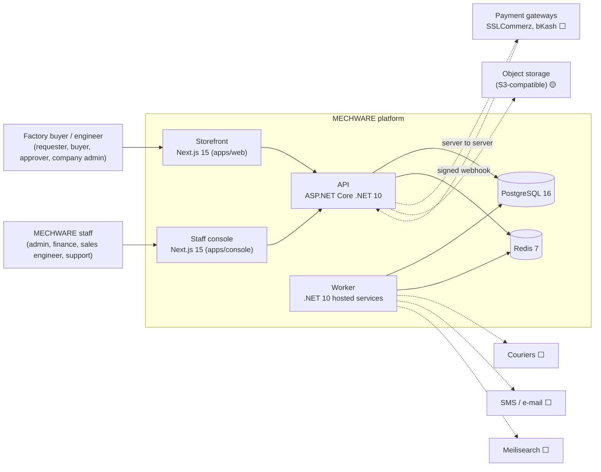

# MECHWARE — Architecture (v2)

> Written 2026-11-05 from the code on `main` and brief v2 (`docs/01_PROJECT_BRIEF.md`). It replaces the v1 document
> (B2C multi-vendor marketplace with Stripe, AWS SNS, Gemini and a seller ledger as launch scope), which is kept in
> `docs/archive/ARCHITECTURE_v1.md`. Where this file and the brief disagree, the brief wins and this file is wrong.
>
> **Status markers:** ✅ built and tested · 🟡 partly built · ⬜ planned (sprint in `docs/MASTER_PLAN.md` §3) · ⏸ after launch

---

## 1. What the system is

A B2B procurement platform where MECHWARE sells industrial automation parts and machinery **directly** to factories and
corporate buyers in Bangladesh: company accounts with several buyers, approvals, credit terms, quotes and VAT invoices.
Authorised distributors (a marketplace) come after launch; the order model already allows several sellers per order.



---

## 2. Code structure and the rules that are enforced

Modular monolith with Clean Architecture (ADR-0001). One deployable API, one worker, one database.

| Project | Holds | May depend on |
|---|---|---|
| `ShopVerse.Domain` | Entities, value objects (`Money`), pure engines (`PricingEngine`, `PromotionEngine`, `CartEngine`, `OrderPricing`, `OrderStateMachine`, `WebhookVerifier`), domain events | nothing (no framework, no I/O) |
| `ShopVerse.Application` | Service interfaces and request/response contracts per module | Domain |
| `ShopVerse.Infrastructure` | EF Core `ShopVerseDbContext`, migrations, service implementations, outbox, Redis, workers, seed | Application, Domain |
| `ShopVerse.Api` | Controllers, authentication, authorisation, middleware, configuration | Application (controllers inject only application ports) |
| `ShopVerse.Worker` | Host for the background services and the `seed-catalog` command | Infrastructure |
| `ShopVerse.Payment` | Reserved for real gateway adapters ⬜ | — |

These are **checked by tests**, not by convention: `backend/tests/ShopVerse.UnitTests/Architecture/LayeringTests.cs`
fails CI if the Domain references any other layer or I/O, if Application references Infrastructure, if Infrastructure
references the API, or if a controller injects anything but an application port.

Frontend: a pnpm monorepo (`frontend/`) with `apps/web`, `apps/console` and shared packages `@mechware/ui` (design
system), `@mechware/api-client` (typed API client and pure form models), `@mechware/config` (Tailwind preset, tsconfig,
security headers, bundle budget). The browser never talks to anything but the API.

---

## 3. Modules

| Module | Status | What exists | Next |
|---|---|---|---|
| Identity & access | ✅ | Users in PostgreSQL; password + TOTP (staff), OTP; rotating refresh tokens with reuse detection; permission-based authorisation; address book; GDPR export/erase; demo accounts only in Development, refused elsewhere (`DemoAccountGuard`); bootstrap admin from secrets | passkeys, step-up auth, PDPO consent |
| Catalogue | ✅ | Categories (materialised path), brands, products, variants, media, slug history, reviews/Q&A, storefront read API with Redis cache | PIM: attribute classes with units, datasheets/CAD, alternatives, lifecycle ⬜ |
| Inventory | ✅ | Stock per warehouse, reservations split across active warehouses, row-locked in a fixed order, CHECK constraint as last guard, expiry sweep | — |
| Companies (B2B) | ✅ | Companies, sites, cost centres, members with roles and spend limits, credit terms; tenancy checked on every call | invitations, KYC |
| Approvals | 🟡 | Rules, ordered approver chains, requests, decisions | wired to orders (`pending_approval`), spend limits and budgets ⬜ |
| Pricing | 🟡 | List / sale price, VAT inclusive (personal) and exclusive (company), promotions and coupons with race-proof limits | price lists, quantity breaks, contract prices ⬜ |
| Cart | 🟡 | `CartEngine` rules (MOQ, pack size, merge, re-validation) | Redis cart store and endpoints ⬜ |
| Orders | ✅ | Idempotent atomic placement, server-side pricing, per-seller sub-orders, state machine with events, cancel, 30-minute unpaid expiry, verified buyers only, at most 3 unpaid orders, delivery address copied from address book or company site | approvals, shipping zones |
| Payments | 🟡 | Provider port, signed webhook inbox, confirmation only after asking the provider server to server; mock provider in Development | SSLCommerz, bKash, COD-OTP, reconciliation, refunds ⬜ |
| Quotes / RFQ | ⬜ | — | sprint 7–9 |
| Quick order (SKU / CSV / BOM) | ⬜ | — | sprint 7–9 |
| Invoicing (Mushak-6.3) | ⬜ | — | sprint 10–12 |
| Search | ⬜ | Outbox already feeds a `search:sync:queue` Redis list | Meilisearch, sprint 5–6 |
| Fulfilment (couriers, RMA) | ⬜ | — | sprint 13–14 |
| Notifications | ⬜ | Outbox events exist | sprint 13–14 |
| Staff console | 🟡 | Sign-in with TOTP, company verification, credit terms | catalogue, pricing (4-eyes), quotes desk, orders, audit viewer |
| Marketplace sellers, payouts, AI assistant | ⏸ | Seller entity and seller isolation only | after launch |

---

## 4. Key flows as built

### 4.1 Placing an order (`POST /api/v1/orders`)

```mermaid
sequenceDiagram
    autonumber
    actor B as Buyer
    participant A as API (OrderService)
    participant PG as PostgreSQL
    B->>A: lines (variant, qty) + Idempotency-Key [+ companyId, address / site, coupons]
    A->>PG: advisory lock per buyer
    A->>PG: replay? same key + same body → return the first order (200)
    A->>PG: buyer active? open unpaid orders < 3? company member with Buyer role, company active?
    A->>PG: resolve delivery address (own address / company site) → copy
    A->>PG: re-price every line from the catalogue; promotions; VAT mode by buyer type
    A->>PG: reserve stock (FOR UPDATE in (variant, warehouse) order, split across warehouses, 30 min)
    A->>PG: one transaction: order + sub-orders + items + event + idempotency key + coupon claims + outbox event [+ credit]
    A-->>B: 201 order number, total, hold expiry
```

The request has no field for a price, tax, discount, total or address text. A failure after the stock hold releases it.

### 4.2 Paying

1. `POST /orders/{id}/payments` (owner only) starts a session with the provider for the order's own total.
2. The provider sends a webhook to `POST /payments/webhooks/{provider}` (anonymous; the HMAC over `timestamp.body` is the authority, 5-minute window, 64 KB cap).
3. The event id goes into an inbox table (duplicates are no-ops).
4. The API **asks the provider directly** whether the payment is paid, for exactly the recorded amount and currency.
5. Only then, under row locks, the order is confirmed and the held stock committed.

A browser redirect confirms nothing.

### 4.3 Background work (`ShopVerse.Worker`)

| Worker | Every | Does |
|---|---|---|
| `ReservationExpiryWorker` | 60 s | releases expired stock holds (`SKIP LOCKED`, same lock order as reservations) |
| `UnpaidOrderExpiryWorker` | 60 s | cancels orders unpaid after 30 minutes and frees their stock and coupon uses |
| `OutboxRelayWorker` | 1 s | publishes outbox events (search sync queue, storefront cache invalidation) with `SKIP LOCKED` |

---

## 5. Data rules

- **Money** is integer minor units (poisha) with banker's rounding, rounded once per line (ADR-0002). Database CHECK
  constraints refuse an order whose totals do not add up.
- **Concurrency** is settled in PostgreSQL: row locks in a fixed order, `xmin` concurrency tokens, unique indexes,
  conditional updates for counters, advisory locks for per-buyer serialisation. Redis locks only reduce contention.
- **Tenancy:** company data is reachable only through `company_members` rows checked on every call; an id the caller
  cannot see answers **404**, a member without the role **403**. ⬜ EF global query filters as a second layer.
- **Snapshots:** order lines, prices and the delivery address are copied into the order; later catalogue or address
  edits never change a placed order. Quotes and invoices will follow the same rule.
- **Events:** domain events are written to `outbox_messages` in the same `SaveChanges` as the change.
- **Audit:** an EF interceptor writes `audit_logs` with secrets redacted; security events are written explicitly.

---

## 6. Security architecture

| Layer | Control | Where |
|---|---|---|
| Edge ⬜ | Cloudflare WAF, bot management, TLS | deployment |
| API | JWT (HS256, `alg`/`iss`/`aud`/time checked), refresh cookie `HttpOnly; Secure; SameSite=Lax; Path=/api/v1/auth` | `JwtBearerAuthenticationHandler`, `JwtTokenService` |
| API | Permission policies, seller isolation, company tenancy | `PermissionAuthorization.cs`, `SellerResourceIsolationHandler`, `CompanyAccess` |
| API | Rate limits per client IP (global 100/min, credentials 5/min in Production, storefront 1,200/min) behind configured proxies | `Program.cs`, `ForwardedHeadersSettings` |
| API | CSP `default-src 'none'`, HSTS, X-Frame-Options, nosniff, CORP; RFC 7807 errors without internals | `SecurityHeadersMiddleware`, `GlobalExceptionHandlingMiddleware` |
| Web, console | CSP, X-Frame-Options, HSTS, COOP, Referrer/Permissions-Policy | `frontend/packages/config/security-headers.js` |
| Startup | Fails closed: missing or published JWT secret, missing storage keys, demo accounts outside Development, malformed proxy list, weak bootstrap admin | options validation, `DemoAccountGuard` |
| CI | CodeQL, Semgrep, Trivy, gitleaks, NuGet/npm audit, OWASP ZAP (nightly) | `.github/workflows/security.yml`, `dast.yml` |

Requirement-by-requirement evidence: `docs/security/ASVS_MATRIX.md`. Threat models: `docs/security/`.

---

## 7. Deployment (target ⬜, sprint 17–18)

- **Front:** Cloudflare in front of the web app, the console and the API (console behind Zero-Trust access).
- **Hosting:** managed containers for API, worker, web and console, in Singapore or Mumbai, subject to the PDPO transfer review.
- **Data:** managed PostgreSQL 16 with point-in-time recovery; managed Redis; S3-compatible storage with signed URLs.
- **Targets:** RPO ≤ 15 min, RTO ≤ 4 h, restore drill every quarter. SLOs as in `docs/100K_GRADE_REVIEW_AND_PLAN.md` §3.5.

**Requirements the code already places on any deployment:**

| Setting | Why |
|---|---|
| `Jwt__Secret` (not the published dev value) | the API will not start without it |
| `Storage__AccessKey`, `Storage__SecretKey` | the API will not start without them |
| Database reachable at boot (outside Development) | the demo-account check reads `users` at startup |
| `ForwardedHeaders__KnownNetworks` / `__KnownProxies` behind a proxy | otherwise every visitor shares the proxy's rate limit |
| `Identity__BootstrapAdmin__*` for the first administrator | Production starts with no accounts |

Local development: `infra/docker/docker-compose.yml` (PostgreSQL, Redis, MinIO, Meilisearch, Mailpit) and the steps in
`README.md`.

---

## 8. How it is tested

| Level | Where | Notes |
|---|---|---|
| Unit, property, fuzz | `backend/tests/ShopVerse.UnitTests` | domain rules, money and pricing properties, JWT attacker model, architecture rules |
| Integration | `backend/tests/ShopVerse.IntegrationTests` | real PostgreSQL (and Redis); races, IDOR, API security, Production-mode hosts |
| Mutation checks | recorded per PR | each money or security guard is removed once to show a test fails |
| Browser E2E | `frontend/packages/e2e` | API + PostgreSQL + production builds of web and console, EN + BN, 360 px |
| Frontend | `pnpm lint` (0 warnings), typecheck, axe, contrast, bundle budget 170 kB | `frontend/` |
| DAST | `dast.yml` | ZAP against the running API |

What every change must prove: `docs/MASTER_PLAN.md` §4–§5 and `.github/pull_request_template.md`.

---

## 9. Decisions

ADRs in `docs/adr/`:

| ADR | Decision | Status |
|---|---|---|
| 0001 | Modular monolith | in force |
| 0002 | Money and rounding | in force |
| 0003 | Parent order / sub-orders | in force; `MW-` numbers; payouts after launch |
| 0004 | Stock reservation | in force |
| 0005 | Search abstraction | ⬜ |
| 0006 | Token strategy | in force; BFF cookies planned |
| 0007 | AI provider | ⏸ |

New decisions (price-list model, quote snapshots, Mushak-6.3 numbering, payment provider choice) each get an ADR before
the code.
