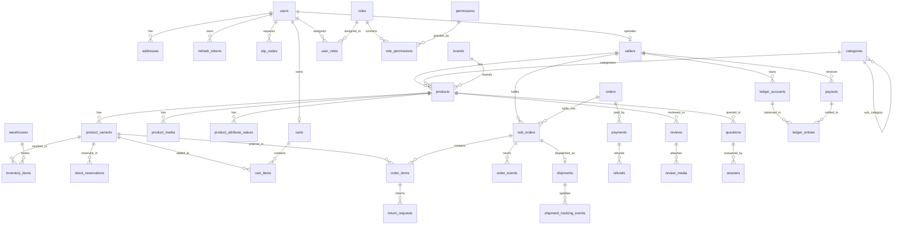

# DATA MODEL SPECIFICATION — MECHWARE

> **Single Source of Truth for Database Schema, Types, Constraints, and Indexes**
> Stack: PostgreSQL 16 + Entity Framework Core 10 (Npgsql) + Dapper

---

## 1. High-Level Entity Relationship Diagram (Mermaid)

---

## 2. Table Specifications by Bounded Context

### 2.1 Identity and Access Control

#### `users`
Core user identity for buyers, seller personnel, and internal staff.

| Column | Type | Constraints | Description |
|---|---|---|---|
| `id` | `uuid` | PK, default `gen_random_uuid()` | Unique user identifier |
| `email` | `varchar(255)` | UNIQUE, nullable | Customer / staff email |
| `phone` | `varchar(20)` | UNIQUE, nullable | International format (e.g. `+88017XXXXXXXX`) |
| `password_hash` | `varchar(255)` | nullable | Argon2id hash (null for OAuth only users) |
| `full_name` | `varchar(150)` | NOT NULL | User's legal or preferred name |
| `avatar_url` | `text` | nullable | Profile picture URL |
| `locale` | `varchar(5)` | NOT NULL, default `'en'` | Default language (`'en'` or `'bn'`) |
| `status` | `varchar(20)` | NOT NULL, default `'active'` | `'active'`, `'suspended'`, `'locked'` |
| `two_factor_enabled` | `boolean` | NOT NULL, default `false` | Mandatory for admin/finance |
| `two_factor_secret` | `text` | nullable | Encrypted TOTP secret key |
| `failed_login_attempts`| `int` | NOT NULL, default `0` | Progressive delay counter |
| `lockout_until` | `timestamptz` | nullable | Timestamp when lockout releases |
| `email_verified_at` | `timestamptz` | nullable | Verification timestamp |
| `phone_verified_at` | `timestamptz` | nullable | SMS OTP verification timestamp |
| `last_login_at` | `timestamptz` | nullable | Audit timestamp |
| `created_at` | `timestamptz` | NOT NULL, default `NOW()` | Audit timestamp |
| `updated_at` | `timestamptz` | NOT NULL, default `NOW()` | Audit timestamp |
| `deleted_at` | `timestamptz` | nullable | Soft delete (GDPR / anonymization) |

**Indexes:**
- `ux_users_email` UNIQUE (`email`) WHERE `deleted_at IS NULL` — fast lookup & unique constraint.
- `ux_users_phone` UNIQUE (`phone`) WHERE `deleted_at IS NULL` — fast phone lookup for OTP auth.
- `ix_users_status` (`status`) — filter active vs suspended users.

#### `addresses`
Saved shipping and billing destinations with Bangladesh administrative hierarchy.

| Column | Type | Constraints | Description |
|---|---|---|---|
| `id` | `uuid` | PK, default `gen_random_uuid()` | Unique address ID |
| `user_id` | `uuid` | FK -> `users(id)` ON DELETE CASCADE | Owner of the address |
| `label` | `varchar(50)` | NOT NULL, default `'Home'` | `'Home'`, `'Office'`, `'Factory'` |
| `recipient_name` | `varchar(150)` | NOT NULL | Contact person for courier |
| `phone` | `varchar(20)` | NOT NULL | Contact phone for delivery call |
| `line1` | `varchar(255)` | NOT NULL | Street, house/road number, industrial zone |
| `line2` | `varchar(255)` | nullable | Floor, suite, building details |
| `area` | `varchar(100)` | NOT NULL | Neighborhood / Sub-locality (e.g. 'Gulshan-1') |
| `district` | `varchar(100)` | NOT NULL | District (e.g. 'Dhaka', 'Chittagong') |
| `division` | `varchar(100)` | NOT NULL | Division (e.g. 'Dhaka', 'Chattogram') |
| `postal_code` | `varchar(20)` | NOT NULL | Postal index |
| `country` | `varchar(2)` | NOT NULL, default `'BD'` | ISO 3166-1 alpha-2 |
| `is_default_shipping`| `boolean` | NOT NULL, default `false` | Primary shipping address |
| `is_default_billing` | `boolean` | NOT NULL, default `false` | Primary billing address |
| `latitude` | `numeric(9,6)` | nullable | Geo coordinate |
| `longitude` | `numeric(9,6)` | nullable | Geo coordinate |
| `created_at` | `timestamptz` | NOT NULL, default `NOW()` | Audit timestamp |
| `updated_at` | `timestamptz` | NOT NULL, default `NOW()` | Audit timestamp |

**Indexes:**
- `ix_addresses_user_id` (`user_id`) — fast retrieval of user address book.

#### `roles`, `permissions`, `role_permissions`, `user_roles`
RBAC foundation mapping granular permissions to roles and users.

- `roles`: `id (uuid PK)`, `name (varchar(50) UNIQUE)`, `description (text)`, `created_at`.
- `permissions`: `id (uuid PK)`, `code (varchar(100) UNIQUE)` (e.g. `'orders.refund'`, `'catalog.create'`), `group (varchar(50))`, `description (text)`.
- `role_permissions`: `role_id (uuid FK)`, `permission_id (uuid FK)`, PK (`role_id`, `permission_id`).
- `user_roles`: `user_id (uuid FK)`, `role_id (uuid FK)`, PK (`user_id`, `role_id`).

#### `refresh_tokens`
Rotating refresh tokens with family tracking for reuse detection.

| Column | Type | Constraints | Description |
|---|---|---|---|
| `id` | `uuid` | PK, default `gen_random_uuid()` | Token record ID |
| `user_id` | `uuid` | FK -> `users(id)` ON DELETE CASCADE | Associated user |
| `token_hash` | `varchar(64)` | NOT NULL, UNIQUE | SHA-256 of token secret |
| `family_id` | `uuid` | NOT NULL | Family ID grouping lineage |
| `is_used` | `boolean` | NOT NULL, default `false` | True once rotated |
| `is_revoked` | `boolean` | NOT NULL, default `false` | True if explicitly invalidated or breached |
| `created_by_ip` | `varchar(45)` | NOT NULL | IPv4 / IPv6 audit |
| `user_agent` | `text` | nullable | Client browser fingerprint |
| `expires_at` | `timestamptz` | NOT NULL | Sliding expiration (7 days) |
| `created_at` | `timestamptz` | NOT NULL, default `NOW()` | Creation timestamp |

**Indexes:**
- `ix_refresh_tokens_token_hash` UNIQUE (`token_hash`) — verification lookup.
- `ix_refresh_tokens_family_id` (`family_id`) — instant cascade revocation upon reuse.

#### `otp_codes`
Phone and email verification codes.

| Column | Type | Constraints | Description |
|---|---|---|---|
| `id` | `uuid` | PK, default `gen_random_uuid()` | Record ID |
| `recipient` | `varchar(255)` | NOT NULL | Phone number or email address |
| `code_hash` | `varchar(64)` | NOT NULL | Salted SHA-256 of 6-digit OTP |
| `type` | `varchar(30)` | NOT NULL | `'phone_verify'`, `'password_reset'`, `'cod_confirm'` |
| `attempts` | `int` | NOT NULL, default `0` | Max 3 attempts before invalidate |
| `is_consumed` | `boolean` | NOT NULL, default `false` | Single-use flag |
| `expires_at` | `timestamptz` | NOT NULL | 5-minute TTL |
| `created_at` | `timestamptz` | NOT NULL, default `NOW()` | Timestamp |

**Indexes:**
- `ix_otp_codes_lookup` (`recipient`, `type`, `is_consumed`) — verify active OTPs.

---

### 2.2 Sellers and KYC

#### `sellers`
Multi-vendor merchant profiles and verification records.

| Column | Type | Constraints | Description |
|---|---|---|---|
| `id` | `uuid` | PK, default `gen_random_uuid()` | Seller ID |
| `user_id` | `uuid` | FK -> `users(id)` ON DELETE RESTRICT | Account owner |
| `store_name` | `varchar(150)` | NOT NULL | Commercial store name |
| `slug` | `varchar(150)` | NOT NULL, UNIQUE | SEO URL slug (`/s/alpha-automation`) |
| `logo_url` | `text` | nullable | Seller logo |
| `banner_url` | `text` | nullable | Storefront header banner |
| `description` | `text` | nullable | Company summary & engineering capabilities |
| `status` | `varchar(30)` | NOT NULL, default `'pending'` | `'pending'`, `'approved'`, `'rejected'`, `'suspended'` |
| `plan` | `varchar(30)` | NOT NULL, default `'free'` | `'free'` (commission only), `'pro'` (monthly) |
| `commission_override_rate` | `numeric(5,4)` | nullable | Overrides category rate if negotiated |
| `rating_avg` | `numeric(3,2)` | NOT NULL, default `0.00` | Seller average rating |
| `rating_count` | `int` | NOT NULL, default `0` | Count of reviews received |
| `response_rate_percent` | `numeric(5,2)` | NOT NULL, default `100.00` | Inquiry response SLA |
| `joined_at` | `timestamptz` | NOT NULL, default `NOW()` | Registration date |
| `approved_at` | `timestamptz` | nullable | Admin approval timestamp |
| `created_at` | `timestamptz` | NOT NULL, default `NOW()` | Audit timestamp |
| `updated_at` | `timestamptz` | NOT NULL, default `NOW()` | Audit timestamp |

**Indexes:**
- `ux_sellers_slug` UNIQUE (`slug`) — storefront lookup.
- `ix_sellers_status` (`status`) — admin moderation views.

#### `seller_documents` (KYC)
Private compliance documents stored in isolated, presigned S3 buckets.

- `id (uuid PK)`, `seller_id (uuid FK)`, `doc_type (varchar(50))` (`'nid'`, `'trade_license'`, `'tin_certificate'`, `'bank_statement'`), `file_path (text)`, `file_name (varchar(255))`, `file_size_bytes (bigint)`, `mime_type (varchar(100))`, `verification_status (varchar(30))` (`'pending'`, `'verified'`, `'rejected'`), `rejection_reason (text)`, `verified_at (timestamptz)`.

---

### 2.3 Product Catalog and Taxonomy

#### `categories`
Hierarchical tree with materialized path for high-speed subtree queries.

| Column | Type | Constraints | Description |
|---|---|---|---|
| `id` | `uuid` | PK, default `gen_random_uuid()` | Category ID |
| `parent_id` | `uuid` | FK -> `categories(id)` ON DELETE RESTRICT | Parent category (null for root) |
| `name_en` | `varchar(150)` | NOT NULL | English name |
| `name_bn` | `varchar(150)` | NOT NULL | Bengali name |
| `slug` | `varchar(150)` | NOT NULL, UNIQUE | Canonical slug (`/c/plcs-controllers`) |
| `materialized_path`| `varchar(255)` | NOT NULL | Path e.g. `root.industrial-automation.plcs` |
| `depth` | `int` | NOT NULL, default `0` | 0 (root), 1 (sub), 2 (leaf) |
| `sort_order` | `int` | NOT NULL, default `0` | Display ordering |
| `image_url` | `text` | nullable | Category banner / tile icon |
| `commission_rate`| `numeric(5,4)` | NOT NULL, default `0.0800` | Default 8% (0.03 to 0.20 range) |
| `attribute_schema`| `jsonb` | NOT NULL, default `'[]'` | JSON Schema defining dynamic filters |
| `seo_title` | `varchar(255)` | nullable | Meta title |
| `seo_description` | `text` | nullable | Meta description |
| `created_at` | `timestamptz` | NOT NULL, default `NOW()` | Timestamp |

**Indexes:**
- `ux_categories_slug` UNIQUE (`slug`) — fast URL routing.
- `ix_categories_path` (`materialized_path` varchar_pattern_ops) — fast hierarchical sub-tree queries.
- `ix_categories_parent_id` (`parent_id`) — menu traversal.

#### `brands`
- `id (uuid PK)`, `name (varchar(100) UNIQUE)`, `slug (varchar(100) UNIQUE)`, `logo_url (text)`, `is_verified (boolean NOT NULL default false)`, `created_at`.

#### `products`
Industrial equipment aggregate root.

| Column | Type | Constraints | Description |
|---|---|---|---|
| `id` | `uuid` | PK, default `gen_random_uuid()` | Product ID |
| `seller_id` | `uuid` | FK -> `sellers(id)` ON DELETE RESTRICT | Listing merchant |
| `category_id` | `uuid` | FK -> `categories(id)` ON DELETE RESTRICT | Primary category |
| `brand_id` | `uuid` | FK -> `brands(id)` ON DELETE SET NULL | Manufacturer brand |
| `title_en` | `varchar(255)` | NOT NULL | English title |
| `title_bn` | `varchar(255)` | NOT NULL | Bengali title |
| `slug` | `varchar(255)` | NOT NULL, UNIQUE | SEO Slug (`/p/siemens-s7-1200-cpu-1214c-a1b2c3`) |
| `short_description_en` | `text` | NOT NULL | PDP highlight summary |
| `short_description_bn` | `text` | NOT NULL | Bengali PDP highlight summary |
| `description_html` | `text` | NOT NULL | Rich text specification details |
| `highlights` | `jsonb` | NOT NULL, default `'[]'` | Bullet point strings array |
| `specs` | `jsonb` | NOT NULL, default `'{}'` | Grouped specs: `{ "Electrical": {...} }` |
| `datasheet_url` | `text` | nullable | PDF technical datasheet URL |
| `cad_model_url` | `text` | nullable | 3D CAD STEP/IGES model link |
| `status` | `varchar(30)` | NOT NULL, default `'draft'` | `'draft'`, `'pending_review'`, `'active'`, `'rejected'`, `'archived'` |
| `condition` | `varchar(30)` | NOT NULL, default `'brand_new'` | `'brand_new'`, `'refurbished'`, `'used'` |
| `warranty_months`| `int` | NOT NULL, default `12` | Warranty period |
| `return_policy_days` | `int` | NOT NULL, default `7` | Return window (days post-delivery) |
| `weight_kg` | `numeric(8,3)` | NOT NULL, default `0.500` | Actual weight for freight calculation |
| `length_cm` | `numeric(8,2)` | NOT NULL, default `10.00` | Dimensional freight |
| `width_cm` | `numeric(8,2)` | NOT NULL, default `10.00` | Dimensional freight |
| `height_cm` | `numeric(8,2)` | NOT NULL, default `10.00` | Dimensional freight |
| `rating_avg` | `numeric(3,2)` | NOT NULL, default `0.00` | Aggregated rating |
| `rating_count` | `int` | NOT NULL, default `0` | Number of verified reviews |
| `sold_count` | `int` | NOT NULL, default `0` | Popularity ranking metric |
| `created_at` | `timestamptz` | NOT NULL, default `NOW()` | Timestamp |
| `updated_at` | `timestamptz` | NOT NULL, default `NOW()` | Timestamp |
| `deleted_at` | `timestamptz` | nullable | Soft deletion |

**Indexes:**
- `ux_products_slug` UNIQUE (`slug`) WHERE `deleted_at IS NULL` — canonical product lookup.
- `ix_products_seller_status` (`seller_id`, `status`) — seller portal catalog view.
- `ix_products_category_status` (`category_id`, `status`) — PLP category listing.
- `ix_products_brand_id` (`brand_id`) — brand store filtering.
- `ix_products_specs_gin` USING GIN (`specs`) — arbitrary JSONB spec querying.

#### `product_variants`
Purchasable SKUs with physical pricing and stock attributes.

| Column | Type | Constraints | Description |
|---|---|---|---|
| `id` | `uuid` | PK, default `gen_random_uuid()` | Variant ID |
| `product_id` | `uuid` | FK -> `products(id)` ON DELETE CASCADE | Parent product |
| `sku` | `varchar(100)` | NOT NULL, UNIQUE | Merchant SKU code (e.g. `MW-SIE-1214C-DC`) |
| `barcode` | `varchar(100)` | nullable | GTIN / EAN barcode |
| `option_values` | `jsonb` | NOT NULL, default `'{}'` | e.g. `{"Voltage": "24V DC", "Power": "0.75kW"}` |
| `price_minor` | `bigint` | NOT NULL | Selling price in poisha/cents |
| `compare_at_price_minor` | `bigint` | nullable | Strike-through reference price |
| `cost_price_minor` | `bigint` | nullable | Seller cost price (for margin analysis) |
| `currency` | `varchar(3)` | NOT NULL, default `'BDT'` | ISO 4217 code |
| `is_default` | `boolean` | NOT NULL, default `false` | Highlighted variant on initial PDP view |
| `status` | `varchar(30)` | NOT NULL, default `'active'` | `'active'`, `'inactive'` |

**Indexes:**
- `ux_product_variants_sku` UNIQUE (`sku`) — SKU uniqueness.
- `ix_product_variants_product_id` (`product_id`) — PDP variant retrieval.

#### `product_media`
- `id (uuid PK)`, `product_id (uuid FK)`, `variant_id (uuid FK nullable)`, `url (text NOT NULL)`, `alt_text (varchar(255))`, `media_type (varchar(20) NOT NULL default 'image')` (`'image'`, `'video'`), `position (int NOT NULL default 0)`, `width (int)`, `height (int)`, `blur_data_url (text)`, `created_at`.

#### `slug_histories`
301 redirects when product or category slugs are updated.
- `id (uuid PK)`, `entity_type (varchar(30))` (`'product'`, `'category'`), `entity_id (uuid NOT NULL)`, `old_slug (varchar(255) NOT NULL UNIQUE)`, `created_at`.

---

### 2.4 Inventory and Warehouses

#### `warehouses`
- `id (uuid PK)`, `seller_id (uuid FK nullable)` (null for MECHWARE central hub), `name (varchar(150))`, `code (varchar(50) UNIQUE)`, `division (varchar(100))`, `district (varchar(100))`, `address (text)`, `is_active (boolean default true)`.

#### `inventory_items`
High-concurrency stock balances.

| Column | Type | Constraints | Description |
|---|---|---|---|
| `id` | `uuid` | PK, default `gen_random_uuid()` | Inventory record ID |
| `variant_id` | `uuid` | FK -> `product_variants(id)` ON DELETE CASCADE | Stock SKU |
| `warehouse_id` | `uuid` | FK -> `warehouses(id)` ON DELETE RESTRICT | Storage depot |
| `on_hand` | `int` | NOT NULL, CHECK (`on_hand >= 0`) | Physical stock in depot |
| `reserved` | `int` | NOT NULL, CHECK (`reserved >= 0`) | Active reservation tokens |
| `low_stock_threshold`| `int` | NOT NULL, default `5` | Alert trigger level |
| `updated_at` | `timestamptz` | NOT NULL, default `NOW()` | Timestamp |

**Constraints:**
- `ck_inventory_available`: `CHECK (on_hand >= reserved)` — mathematical guarantee against overselling.
- `ux_inventory_variant_warehouse`: UNIQUE (`variant_id`, `warehouse_id`).

#### `stock_reservations`
15-minute checkout reservation hold.

| Column | Type | Constraints | Description |
|---|---|---|---|
| `id` | `uuid` | PK, default `gen_random_uuid()` | Reservation ID |
| `variant_id` | `uuid` | FK -> `product_variants(id)` ON DELETE RESTRICT | Reserved item |
| `warehouse_id` | `uuid` | FK -> `warehouses(id)` ON DELETE RESTRICT | Sourced depot |
| `reference_id` | `uuid` | NOT NULL | `cart_id` or `order_id` |
| `quantity` | `int` | NOT NULL, CHECK (`quantity > 0`) | Reserved quantity |
| `status` | `varchar(30)` | NOT NULL, default `'active'` | `'active'`, `'fulfilled'`, `'expired'`, `'cancelled'` |
| `expires_at` | `timestamptz` | NOT NULL | `NOW() + INTERVAL '15 minutes'` |
| `created_at` | `timestamptz` | NOT NULL, default `NOW()` | Timestamp |

**Indexes:**
- `ix_stock_reservations_cleanup` (`expires_at`, `status`) WHERE `status = 'active'` — background release job.
- `ix_stock_reservations_reference` (`reference_id`) — order completion lookup.

---

### 2.5 Shopping Cart and Promotions

#### `carts` and `cart_items`
- `carts`: `id (uuid PK)`, `user_id (uuid FK nullable)`, `guest_token (varchar(64) UNIQUE nullable)`, `currency (varchar(3) default 'BDT')`, `created_at`, `updated_at`.
- `cart_items`: `id (uuid PK)`, `cart_id (uuid FK ON DELETE CASCADE)`, `variant_id (uuid FK)`, `quantity (int NOT NULL CHECK (quantity > 0))`, `saved_for_later (boolean default false)`, `price_snapshot_minor (bigint NOT NULL)`, `created_at`, `updated_at`.
  - UNIQUE (`cart_id`, `variant_id`).

#### `promotions` and `coupons`
- `promotions`: `id (uuid PK)`, `title (varchar(200))`, `promo_type (varchar(50))` (`'percentage_discount'`, `'fixed_discount'`, `'free_shipping'`, `'tiered_discount'`), `discount_value (numeric(10,2))`, `max_discount_minor (bigint nullable)`, `min_spend_minor (bigint default 0)`, `priority (int default 0)`, `is_stackable (boolean default false)`, `funded_by (varchar(20) default 'platform')` (`'platform'`, `'seller'`), `seller_id (uuid FK nullable)`, `starts_at (timestamptz)`, `ends_at (timestamptz)`, `status (varchar(20) default 'active')`.
- `coupons`: `id (uuid PK)`, `promotion_id (uuid FK)`, `code (varchar(50) UNIQUE)`, `usage_limit_total (int nullable)`, `usage_limit_per_user (int default 1)`, `usage_count (int default 0)`.
- `coupon_usages`: `id (uuid PK)`, `coupon_id (uuid FK)`, `user_id (uuid FK nullable)`, `order_id (uuid FK)`, `discount_amount_minor (bigint)`, `created_at`.

---

### 2.6 Orders and Multi-Vendor Fulfillment

#### `orders` (Parent Order Aggregate)

| Column | Type | Constraints | Description |
|---|---|---|---|
| `id` | `uuid` | PK, default `gen_random_uuid()` | Master Order ID |
| `order_number` | `varchar(30)` | NOT NULL, UNIQUE | Format: `SV-YYMMDD-XXXXXX` |
| `user_id` | `uuid` | FK -> `users(id)` ON DELETE SET NULL | Registered buyer (or null) |
| `guest_email` | `varchar(255)` | nullable | For guest checkout |
| `guest_phone` | `varchar(20)` | nullable | For guest checkout & OTP |
| `currency` | `varchar(3)` | NOT NULL, default `'BDT'` | Currency code |
| `subtotal_minor` | `bigint` | NOT NULL | Sum of item subtotals |
| `discount_total_minor` | `bigint` | NOT NULL, default `0` | Platform + seller discounts |
| `shipping_total_minor` | `bigint` | NOT NULL, default `0` | Combined delivery fees |
| `tax_total_minor` | `bigint` | NOT NULL, default `0` | Calculated VAT total |
| `grand_total_minor` | `bigint` | NOT NULL | `subtotal - discount + shipping + tax` |
| `payment_status` | `varchar(30)` | NOT NULL, default `'unpaid'` | `'unpaid'`, `'authorized'`, `'paid'`, `'refunded'`, `'partially_refunded'` |
| `shipping_address_snapshot`| `jsonb` | NOT NULL | Frozen delivery destination |
| `billing_address_snapshot` | `jsonb` | NOT NULL | Frozen invoice details |
| `source` | `varchar(20)` | NOT NULL, default `'web'` | `'web'`, `'app'`, `'rfq_conversion'` |
| `customer_notes` | `text` | nullable | Delivery remarks |
| `placed_at` | `timestamptz` | NOT NULL, default `NOW()` | Timestamp |

**Indexes:**
- `ux_orders_order_number` UNIQUE (`order_number`) — customer order tracking.
- `ix_orders_user_placed` (`user_id`, `placed_at` DESC) — customer account portal order history.

#### `sub_orders` (Per-Seller Fulfillment Unit)

| Column | Type | Constraints | Description |
|---|---|---|---|
| `id` | `uuid` | PK, default `gen_random_uuid()` | SubOrder ID |
| `order_id` | `uuid` | FK -> `orders(id)` ON DELETE CASCADE | Parent aggregate |
| `seller_id` | `uuid` | FK -> `sellers(id)` ON DELETE RESTRICT | Fulfilling seller |
| `sub_order_number` | `varchar(35)` | NOT NULL, UNIQUE | e.g. `SV-261029-A7K92M-01` |
| `status` | `varchar(35)` | NOT NULL, default `'pending_payment'` | Lifecycle state (see Section 8.5) |
| `subtotal_minor` | `bigint` | NOT NULL | Seller's item subtotal |
| `discount_minor` | `bigint` | NOT NULL, default `0` | Seller-funded discount |
| `shipping_fee_minor` | `bigint` | NOT NULL, default `0` | Allocated shipping charge |
| `tax_minor` | `bigint` | NOT NULL, default `0` | Allocated VAT |
| `commission_rate` | `numeric(5,4)` | NOT NULL | Effective commission rate applied |
| `commission_amount_minor`| `bigint` | NOT NULL | Platform commission earned |
| `seller_earning_minor` | `bigint` | NOT NULL | Payable: `subtotal - discount - commission` |
| `completed_at` | `timestamptz` | nullable | Delivery + return window passed |
| `created_at` | `timestamptz` | NOT NULL, default `NOW()` | Timestamp |

**Indexes:**
- `ix_sub_orders_seller_status` (`seller_id`, `status`) — seller portal fulfillment dashboard.
- `ix_sub_orders_order_id` (`order_id`) — master order expansion.

#### `order_items`
- `id (uuid PK)`, `sub_order_id (uuid FK ON DELETE CASCADE)`, `variant_id (uuid FK ON DELETE RESTRICT)`, `product_title_snapshot (varchar(255))`, `variant_label_snapshot (varchar(150))`, `image_url_snapshot (text)`, `sku (varchar(100))`, `unit_price_minor (bigint NOT NULL)`, `quantity (int NOT NULL CHECK (quantity > 0))`, `discount_minor (bigint NOT NULL default 0)`, `tax_minor (bigint NOT NULL default 0)`, `line_total_minor (bigint NOT NULL)`.

#### `order_events` (Immutable Audit Timeline)
- `id (uuid PK)`, `order_id (uuid FK nullable)`, `sub_order_id (uuid FK nullable)`, `from_status (varchar(35))`, `to_status (varchar(35) NOT NULL)`, `actor_id (uuid nullable)`, `actor_role (varchar(30) NOT NULL)`, `notes (text)`, `created_at (timestamptz NOT NULL default NOW())`.

#### `shipments` and `shipment_tracking_events`
- `shipments`: `id (uuid PK)`, `sub_order_id (uuid FK UNIQUE)`, `courier_code (varchar(50))` (`'steadfast'`, `'pathao'`, `'paperfly'`, `'internal_freight'`), `tracking_number (varchar(100) NOT NULL)`, `label_url (text)`, `status (varchar(35) NOT NULL default 'manifested')`, `chargeable_weight_kg (numeric(8,3))`, `shipping_cost_minor (bigint)`, `estimated_delivery_at (timestamptz)`, `delivered_at (timestamptz)`.
- `shipment_tracking_events`: `id (uuid PK)`, `shipment_id (uuid FK ON DELETE CASCADE)`, `courier_status (varchar(100))`, `location (varchar(150))`, `description (text)`, `event_timestamp (timestamptz NOT NULL)`.

---

### 2.7 Payments and Double-Entry Financial Ledger

#### `payments`
Customer transaction ledger with idempotency and encrypted payloads.

| Column | Type | Constraints | Description |
|---|---|---|---|
| `id` | `uuid` | PK, default `gen_random_uuid()` | Payment ID |
| `order_id` | `uuid` | FK -> `orders(id)` ON DELETE RESTRICT | Target order |
| `provider` | `varchar(30)` | NOT NULL | `'stripe'`, `'bkash'`, `'sslcommerz'`, `'cod'` |
| `provider_transaction_id`| `varchar(150)` | UNIQUE, nullable | External transaction ref |
| `idempotency_key` | `varchar(100)` | NOT NULL, UNIQUE | Client / Gateway idempotency token |
| `amount_minor` | `bigint` | NOT NULL | Transaction value |
| `currency` | `varchar(3)` | NOT NULL, default `'BDT'` | Currency code |
| `status` | `varchar(30)` | NOT NULL, default `'initiated'` | `'initiated'`, `'authorized'`, `'captured'`, `'failed'`, `'refunded'` |
| `raw_payload_encrypted` | `text` | nullable | AES-256 encrypted gateway response |
| `error_message` | `text` | nullable | Failure reason |
| `created_at` | `timestamptz` | NOT NULL, default `NOW()` | Audit timestamp |
| `captured_at` | `timestamptz` | nullable | Timestamp of successful capture |

**Indexes:**
- `ux_payments_idempotency` UNIQUE (`idempotency_key`) — prevents double-charging.
- `ix_payments_order_id` (`order_id`) — order payment lookup.

#### `refunds`
- `id (uuid PK)`, `payment_id (uuid FK)`, `order_item_id (uuid FK nullable)`, `amount_minor (bigint NOT NULL)`, `currency (varchar(3) default 'BDT')`, `reason (varchar(255))`, `status (varchar(30) default 'pending')`, `provider_refund_id (varchar(150))`, `created_at (timestamptz)`.

#### `ledger_accounts` and `ledger_entries` (Double-Entry Financial System)
Guarantees mathematical balance: for every transaction, $\sum \text{Debits} == \sum \text{Credits}$.

- `ledger_accounts`:
  - `id (uuid PK)`, `seller_id (uuid FK nullable)` (null for Platform Operating / Escrow accounts), `account_type (varchar(50) NOT NULL)`:
    - `'platform_escrow'` (asset)
    - `'platform_revenue_commission'` (revenue)
    - `'platform_shipping_payable'` (liability)
    - `'platform_tax_payable'` (liability)
    - `'seller_payable'` (liability)
    - `'customer_receivable'` (asset)
  - `currency (varchar(3) NOT NULL default 'BDT')`, `created_at`.
- `ledger_entries`:
  - `id (uuid PK)`, `transaction_batch_id (uuid NOT NULL)` (groups balanced debit/credit legs), `account_id (uuid FK -> ledger_accounts(id))`, `entry_type (varchar(10) NOT NULL CHECK (entry_type IN ('debit', 'credit')))`, `amount_minor (bigint NOT NULL CHECK (amount_minor > 0))`, `reference_type (varchar(50) NOT NULL)` (`'order'`, `'commission'`, `'refund'`, `'payout'`), `reference_id (uuid NOT NULL)`, `description (text)`, `created_at (timestamptz NOT NULL default NOW())`.

**Indexes:**
- `ix_ledger_entries_batch` (`transaction_batch_id`) — verification of zero-sum balanced entries.
- `ix_ledger_entries_account` (`account_id`, `created_at`) — account statement generation.

#### `payouts`
- `id (uuid PK)`, `seller_id (uuid FK)`, `payout_batch_number (varchar(50) UNIQUE)`, `amount_minor (bigint NOT NULL CHECK (amount_minor >= 50000))` (Min 500 BDT), `payout_method (varchar(30))` (`'bank_transfer'`, `'bkash'`), `payout_details_snapshot (jsonb)`, `status (varchar(30) default 'pending')` (`'pending'`, `'processing'`, `'completed'`, `'failed'`), `provider_reference (varchar(150))`, `period_start (timestamptz)`, `period_end (timestamptz)`, `processed_at (timestamptz)`, `created_at`.

---

### 2.8 Customer Service: Returns, Reviews, and Q&A

#### `return_requests` (RMA)
- `id (uuid PK)`, `order_item_id (uuid FK UNIQUE)`, `user_id (uuid FK)`, `seller_id (uuid FK)`, `reason (varchar(100) NOT NULL)`, `details (text)`, `photos (text[] NOT NULL default '{}')`, `status (varchar(35) NOT NULL default 'pending')` (`'pending'`, `'approved'`, `'rejected'`, `'item_received'`, `'refunded'`, `'replaced'`), `admin_notes (text)`, `created_at`, `updated_at`.

#### `reviews` and `review_media`
- `reviews`: `id (uuid PK)`, `product_id (uuid FK)`, `user_id (uuid FK)`, `order_item_id (uuid FK UNIQUE)` (strictly verified purchase), `rating (int NOT NULL CHECK (rating BETWEEN 1 AND 5))`, `title (varchar(200))`, `body (text NOT NULL)`, `status (varchar(30) default 'pending')` (`'pending'`, `'published'`, `'rejected'`), `helpful_count (int default 0)`, `seller_reply (text)`, `seller_replied_at (timestamptz)`, `created_at`.
- `review_media`: `id (uuid PK)`, `review_id (uuid FK ON DELETE CASCADE)`, `media_url (text)`, `created_at`.

#### `questions` and `answers`
- `questions`: `id (uuid PK)`, `product_id (uuid FK)`, `user_id (uuid FK)`, `question_text (text NOT NULL)`, `is_approved (boolean default false)`, `created_at`.
- `answers`: `id (uuid PK)`, `question_id (uuid FK ON DELETE CASCADE)`, `user_id (uuid FK)`, `is_seller_or_staff (boolean default false)`, `answer_text (text NOT NULL)`, `is_approved (boolean default false)`, `created_at`.

---

### 2.9 CMS, Notifications, and System Infrastructure

#### `cms_banners`, `cms_sections`, `cms_pages`
- Structured dynamic storefront CMS with start/end schedule and device targeting (`desktop`, `mobile`, `all`).

#### `notifications`
- `id (uuid PK)`, `user_id (uuid FK ON DELETE CASCADE)`, `type (varchar(50) NOT NULL)`, `channel (varchar(20) NOT NULL)` (`'in_app'`, `'email'`, `'sms'`), `title (varchar(255))`, `body (text NOT NULL)`, `action_url (text)`, `read_at (timestamptz nullable)`, `created_at`.

#### `outbox_messages` (Reliable Distributed Events)
Guarantees At-Least-Once event publishing without dual-write inconsistency.

| Column | Type | Constraints | Description |
|---|---|---|---|
| `id` | `uuid` | PK, default `gen_random_uuid()` | Outbox Event ID |
| `event_type` | `varchar(150)` | NOT NULL | e.g. `'OrderPlacedDomainEvent'` |
| `aggregate_type` | `varchar(100)` | NOT NULL | e.g. `'Order'` |
| `aggregate_id` | `uuid` | NOT NULL | ID of entity |
| `payload` | `jsonb` | NOT NULL | Complete serialized event payload |
| `occurred_at` | `timestamptz` | NOT NULL, default `NOW()` | Event timestamp |
| `processed_at` | `timestamptz` | nullable | Timestamp when relayed to queue |
| `retry_count` | `int` | NOT NULL, default `0` | Relay attempts |
| `error` | `text` | nullable | Last relay failure message |

**Indexes:**
- `ix_outbox_unprocessed` (`processed_at`, `occurred_at`) WHERE `processed_at IS NULL` — high-speed poller index.

#### `idempotency_records`
- `key (varchar(100) PK)`, `user_id (uuid nullable)`, `endpoint (varchar(255) NOT NULL)`, `request_hash (varchar(64) NOT NULL)`, `response_status_code (int NOT NULL)`, `response_body (jsonb NOT NULL)`, `created_at (timestamptz default NOW())`, `expires_at (timestamptz NOT NULL)` (24-hour TTL).

#### `audit_logs`
- `id (uuid PK)`, `actor_id (uuid nullable)`, `actor_email (varchar(255))`, `actor_role (varchar(50))`, `action (varchar(50) NOT NULL)` (`'create'`, `'update'`, `'delete'`, `'login'`, `'refund_override'`), `entity_name (varchar(100) NOT NULL)`, `entity_id (uuid NOT NULL)`, `old_values (jsonb nullable)`, `new_values (jsonb nullable)`, `ip_address (varchar(45))`, `user_agent (text)`, `created_at (timestamptz default NOW())`.

---
