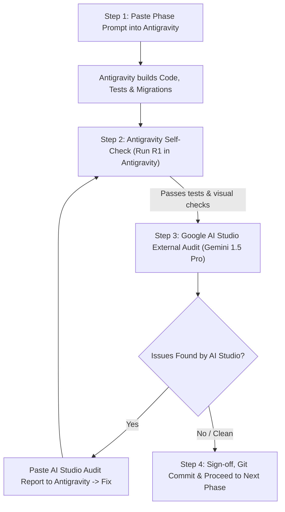

# MECHWARE Platform — Master Execution & Dual-Audit Guide (From Start to Launch)

> This guide provides the exact step-by-step procedure to build, review, and launch the MECHWARE Industrial Commerce & Automation Platform ($100K Agency Standard) using **Google Antigravity** as the Builder and **Google AI Studio (Gemini 1.5 Pro)** as the Independent Senior Auditor.

---

## 1. The Core 4-Step Cycle for Every Phase

Never build everything at once. Build phase by phase using this strict **Build → Self-Check → External Audit → Sign-off** loop:



---

## 2. Step-by-Step Roadmap (Phase 0 to Phase 14)

### Milestone 1: Blueprint & Foundation (Days 1–3)
- **Phase 0 (Architecture & Plan)**:
  - Antigravity reads `docs/01_PROJECT_BRIEF.md`, `docs/COMPANY_PROFILE.md`, `docs/02_DESIGN_SYSTEM.md`.
  - Produces `ARCHITECTURE.md`, `DATA_MODEL.md` (PostgreSQL ER schema), `API_CONTRACT.md`, and `PROGRESS.md`.
- **Phase 1 (C# 13 / .NET 10 API + Next.js 15 Monorepo)**:
  - ASP.NET Core Clean Architecture solution + Next.js 15 frontend monorepo.
  - Docker Compose (`docker-compose.yml`: Postgres 16, Redis 7, Meilisearch, MinIO, Mailpit).
  - CI pipeline + strongly-typed Money value object (`decimal` precision).
- **Phase 2 (Design System & UI Component Library)**:
  - MECHWARE Cybernetic Tech Theme: Midnight Navy (`#060B18`), Electric Cyan / Mech Teal (`#00E5FF` / `#00A8B5`), Royal Industrial Navy (`#0F3E7D`).
  - All Radix/shadcn UI components + `/design-system` showcase page.

### Milestone 2: Core Engine, Identity & Search (Days 4–7)
- **Phase 3 (Identity, Auth, RBAC & Audit Log)**:
  - JWT (15-min) + httpOnly refresh token family with reuse detection.
  - Phone OTP verification, TOTP 2FA, Custom permission attributes, EF Core AuditLog interceptor.
- **Phase 4 (Catalog, High-Concurrency Inventory & Seed Data)**:
  - EF Core entities: Categories, Brands, Products, Variants (SKUs), Media, Warehouses, Inventory.
  - High-concurrency row-level locking (`SELECT ... FOR UPDATE`) + Redis distributed locks.
  - Deterministic 400+ realistic industrial automation seed products (Siemens, Mitsubishi, Delta, Made in Bangladesh Machinery).
- **Phase 5 (Search Engine & Discovery)**:
  - Meilisearch integration with typo tolerance, faceted filtering (voltage, power, brand, speed), instant autocomplete (< 50ms), and Bangla/Banglish query transliteration.

### Milestone 3: Storefront & Purchasing Pipeline (Days 8–12)
- **Phase 6 (Storefront Shell & Homepage)**:
  - Sticky industrial header, mega menu, hero cybernetic banner with slide-out RFQ quick actions.
  - 12 CMS sections, client logos strip (Square, Singer, Hisense, RFL), mobile bottom navigation.
- **Phase 7 (PLP & Product Detail Page - PDP)**:
  - Spec-dense industrial product page: 3-column layout, variant picker, datasheet PDF download, CAD links, stock status, delivery cut-off timer, verified reviews with photo gallery.
- **Phase 8 (Cart, Promotions, Checkout & Payment Gateway)**:
  - **Highest risk phase**: Redis cart merge, pure C# promotions engine, atomic checkout transaction with `Idempotency-Key`.
  - Payment providers: Stripe, SSLCommerz, bKash, Cash on Delivery (with mandatory phone OTP).
  - HMAC webhook signature verification, zero price tampering on client.

### Milestone 4: Operations, Post-Purchase & Seller Center (Days 13–17)
- **Phase 9 (Post-Purchase, Courier Tracking & Customer Account)**:
  - Order state machine, shipment tracking adapters, return/RMA wizard, React Email templates in Mailpit.
  - Customer portal: order tracking stepper, vector PDF invoice downloads (QuestPDF).
- **Phase 10 (Seller Center & Double-Entry Financial Ledger)**:
  - Multi-vendor seller onboarding, product management, payout calculation.
  - Double-entry accounting ledger in C# (Debit == Credit invariant strictly enforced).
- **Phase 11 (Admin Console)**:
  - Stripe/Shopify-style dense admin dashboard: KPI cards, orders manager, catalog manager, KYC approvals, CMS banner editor, audit log diff viewer.

### Milestone 5: Intelligence, Hardening & Launch (Days 18–21)
- **Phase 12 (Google Gemini AI Features)**:
  - Server-side `AiProvider` with secure `GEMINI_API_KEY`.
  - Natural-language search ("Siemens 2.2kW VFD with Modbus"), AI review summary, shopping assistant chat, automated seller listing assistant.
- **Phase 13 (Hardening: Performance, SEO, Security)**:
  - Mobile Lighthouse ≥ 90, zero layout shift (CLS < 0.05), OWASP ASVS audit, rate limit tests.
- **Phase 14 (Load Testing & Production Deployment)**:
  - k6 load tests (5,000 concurrent users, zero overselling in flash sales), Docker production compose, monitoring (Sentry + Grafana), deployment runbook.

---

## 3. How to Execute Antigravity's Internal Self-Check

After Antigravity says "Phase X is completed", **DO NOT take its word for granted.** Force it to run its own self-test:

### Prompt to type in Antigravity:
```text
Run R1 Phase Sign-off Review on Phase [X] against docs/01_PROJECT_BRIEF.md, docs/COMPANY_PROFILE.md, and docs/02_DESIGN_SYSTEM.md.
Open the browser, take screenshots at 360px, 768px and 1440px in both light and dark mode, run all unit/integration tests, and give me a table of Requirements vs Status with evidence. Fix any partial or missing items before reporting.
```

### What Antigravity does automatically:
1. Runs `dotnet test` (for backend) and `pnpm test` / `pnpm build` (for frontend).
2. Launches headless browser / Chrome to capture mobile and desktop screenshots.
3. Tests accessibility using automated axe checks.
4. Reports any broken links, console errors, or unhandled edge cases.

---

## 4. How to Execute Google AI Studio's External Independent Audit

Once Antigravity passes its own self-check, bring in **Google AI Studio (Gemini 1.5 Pro)** as the external third-party auditor.

### Step 1: Open Google AI Studio
1. Open [aistudio.google.com](https://aistudio.google.com/).
2. Select Model: **Gemini 1.5 Pro** (set Temperature to `0.2` for strict, deterministic analysis).

### Step 2: Set System Instructions
In the **System Instructions** box, paste:
```text
You are a Principal Software Architect, Staff Cybersecurity Auditor, and Lead Product Designer at a top-tier digital engineering agency. Your job is to strictly audit code and architectural documents for an enterprise $100K industrial e-commerce platform (MECHWARE). 
Be extremely critical. Do not flatter. Look for:
1. Missing edge cases, race conditions, or concurrency flaws.
2. Security vulnerabilities (OWASP Top 10, IDOR, token handling, webhook spoofing, client price trust).
3. Deviations from the project brief or design system.
4. Poor UX, amateurish styling, or template-like shortcuts.
Provide an actionable Audit Matrix: Severity (Critical / High / Medium / Low), File/Location, Flaw Explanation, and the Exact Code Fix.
```

### Step 3: Provide the Context & Phase Files
1. Click the **+** (Add files) button in AI Studio and attach:
   - `docs/01_PROJECT_BRIEF.md`
   - `docs/02_DESIGN_SYSTEM.md`
   - The files created or changed in this phase (e.g. `OrderService.cs`, `CheckoutController.cs`, `page.tsx`).
   *(Gemini 1.5 Pro has a 2,000,000 token context window, so you can upload whole folders or zip files!)*

### Step 4: Paste User Prompt in AI Studio
```text
Audit the attached implementation of Phase [X] against our Project Brief and Design System. Run a full code, architecture, and security review. List every flaw that prevents this from being a true USD 100,000 enterprise-grade build.
```

### Step 5: Deliver the Audit Back to Antigravity
When AI Studio generates the audit report, copy the text, return to Antigravity, and paste:
```text
Google AI Studio External Senior Audit has flagged the following issues on Phase [X]:
[PASTE AI STUDIO AUDIT REPORT HERE]

Resolve every Critical, High, and Medium issue immediately. Update the code, run regression tests, and show me the before/after proof.
```

---

## 5. Ready to Start Phase 0 Right Now

Open Antigravity and enter this exact kickoff instruction:

```text
START PHASE 0: Read docs/01_PROJECT_BRIEF.md, docs/COMPANY_PROFILE.md, and docs/02_DESIGN_SYSTEM.md. Formulate the complete MECHWARE Architecture (C# 13 / .NET 10 + Next.js 15), PostgreSQL ER diagram, API Contract, and PROGRESS.md task list.
```
