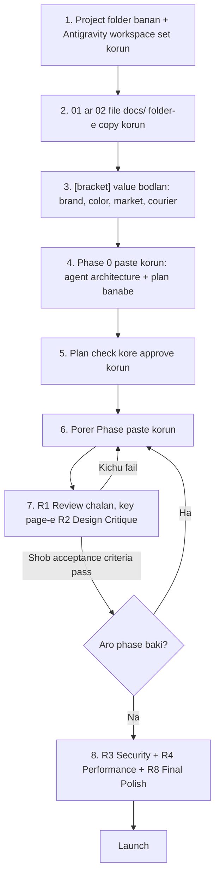

# Prompt Pack v2: USD 100K E-commerce (Details version)

## Ager prompt-e shomossha ki chilo

Choto prompt-e AI agent nijer moto kore baki fank puron kore. Tai site "template"-er moto dekhay. USD 100K-er agency ashole dami hoy 3 ta karone:
1. **Lekha specification**: kon page-e ki thakbe, ki rule mene cholbe.
2. **Design system**: protiti color, font, spacing ar animation age theke thik kora.
3. **Review**: protiti dhap-er por kora check kora hoy.

Tai ei bar prompt-ke **4 ta document-e** bhag korechi. Spec-gulo project-er `docs/` folder-e thakbe, ar agent protita phase-e ogulo pore nebe. Chat-er prompt choto hoy, kintu agent puro ~1,200 line-er spec mene kaj kore. Professional AI-driven development emon-i hoy.

---

## Architecture: Enterprise Hybrid (C# .NET 8/9 + Next.js 15)

Apnar chawa onujayi jekhane C# shobcheye shoktishali, shekhaney C# boshiyeci:
1. **Core Backend & Financial Engine (C# ASP.NET Core 8/9, EF Core, Clean Architecture)**:
   - Order processing, payment gateway settlement, concurrency lock (flash sale-e 10,000 lok ek-i stock kinle oversell bondho kora).
   - Double-entry accounting ledger (C#-er native 128-bit `decimal` precision diye 1 poyshar-o hishab gonogol hobe na).
   - Fast background workers, outbox pattern, Hangfire/BackgroundService.
2. **Customer Storefront & Admin Web UI (Next.js 15 App Router, TypeScript, Tailwind CSS, shadcn/ui)**:
   - Top-tier SEO, Core Web Vitals (LCP < 2.5s), responsive mobile-first UI, micro-interactions, dark mode.
   - C# Web API theke auto-generated typed API client use kore frontend cholbe.

---

## File-gulo

| File | Ki ache | Kokhon use korben |
|---|---|---|
| [01_PROJECT_BRIEF.md](file:///C:/Users/parve/.gemini/antigravity/brain/a51358d0-cf2a-4db7-b503-627d7a5fd382/prompt_pack_v2/01_PROJECT_BRIEF.md) | Business, persona, KPI, tech stack, architecture, **domain model**, **business rule** (pricing, coupon, stock, COD, refund, seller commission ar ledger), role-permission, notification, security, SEO, analytics, legal, **Gemini AI feature** | `docs/` folder-e copy korben, agent shob shomoy porbe |
| [02_DESIGN_SYSTEM.md](file:///C:/Users/parve/.gemini/antigravity/brain/a51358d0-cf2a-4db7-b503-627d7a5fd382/prompt_pack_v2/02_DESIGN_SYSTEM.md) | Color token (WCAG pass kore), typography (Bangla font shoho), spacing, shadow, motion, component spec, **protiti page-er section dhore layout**, conversion-er niyom, copywriting, accessibility | `docs/` folder-e copy korben |
| [03_PHASE_PROMPTS.md](file:///C:/Users/parve/.gemini/antigravity/brain/a51358d0-cf2a-4db7-b503-627d7a5fd382/prompt_pack_v2/03_PHASE_PROMPTS.md) | **Phase 0–14 (15 ta phase)**. Protita phase-e task list, test ar acceptance criteria ache | Ekta ekta kore chat-e paste korben |
| [04_REVIEW_PROMPTS.md](file:///C:/Users/parve/.gemini/antigravity/brain/a51358d0-cf2a-4db7-b503-627d7a5fd382/prompt_pack_v2/04_REVIEW_PROMPTS.md) | Phase sign-off, premium design critique, security, performance, bug report, change request, context refresh, final polish | Protita phase-er por, ar kichu bhul hole |

---

## Dhape dhape kivabe korben



**Folder structure (setup-er por):**
```
shopverse/
└── docs/
    ├── 01_PROJECT_BRIEF.md
    └── 02_DESIGN_SYSTEM.md
```

---

## Ja nijer moto bodlate hobe (`[bracket]` gulo)

- Brand name, tagline, ar chaile color (`02_DESIGN_SYSTEM.md` section 2.1)
- Market (Bangladesh / international), VAT %, COD limit
- Courier (Pathao/RedX/Steadfast), SMS gateway
- Seller-er approval kotogulo product porjonto lagbe, minimum payout

> [!WARNING]
> **Gemini API key kokhono prompt-e ba chat-e paste korben na.** Project-er `apps/api/.env` file-e `GEMINI_API_KEY=...` hishebe rakhben. Brief-e niyom dewa ache je key shudhu server-e thakbe. Phase 12-te ekta check-o ache: key browser bundle-e dhukle build fail korbe. `.env` file git-e uthaben na.

---

## Kichu shotti kotha

> [!IMPORTANT]
> - Eta **boro project**. AI agent diyeo shob phase shesh korte **koyek shoptaho theke mash** lagte pare. Ek-ek phase-e onek session lagbe.
> - Protita phase-er **acceptance criteria nijer chokhe check** korben. Agent "done" bollei bishshash korben na. R1 review sei jonnoi.
> - Payment (bKash, SSLCommerz, Stripe) ar courier-er **sandbox account** nijeke khulte hobe. Live korar age merchant agreement lagbe.
> - Launch-er age ekjon human developer diye **security ar payment flow** ekbar review koriye neya bhalo.

## Tips

- Phase 0 ar Phase 8 (checkout/payment) sobcheye gurutto-purno. Tara-huro korben na.
- Boro phase-e `/plan` diye shuru korun. Onek shomoy dhore nijer moto kaj korate chaile `/goal` din, jemon: `/goal Complete Phase 6 until all acceptance criteria pass`.
- Notun session shuru korle prothome **R7 (Context Refresh)** din, jate agent shob rule abar pore nay.
- Kono page pochondo na hole **R2**-te shei page-er naam boshiye chalan. Kono site-er screenshot reference dile result aro bhalo hoy.
