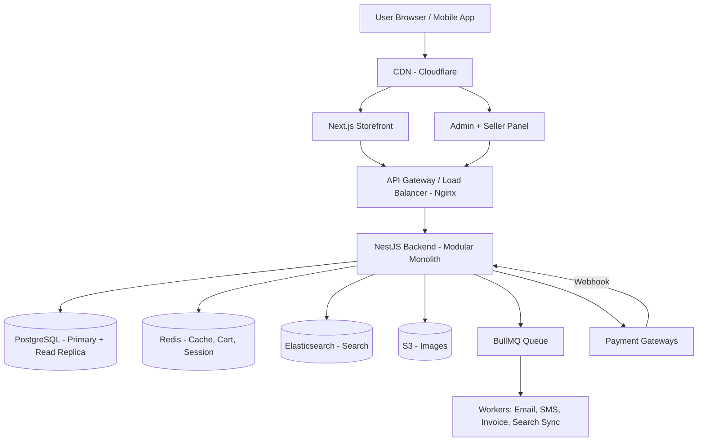
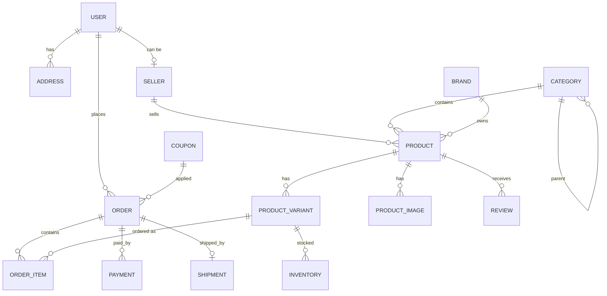
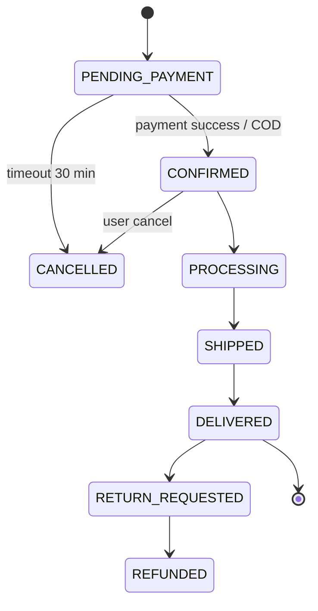
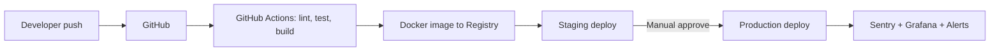

# Amazon-er moto E-commerce Platform: Full Guideline ($50K level)

> [!IMPORTANT]
> Ekta $50K website shudhu sundor design diye hoy na. Ei 5 ta jinish thaka lagbe: **Scalable architecture, fast performance (Lighthouse 90+), strong security, clean admin/seller tools, ar proper testing + DevOps.** Ei guideline e ei 5 ta pillar dhore shob sajano hoyeche.

---

## 1. Platform er Scope (ki ki thakbe)

| Panel | Ke use korbe | Main features |
|---|---|---|
| **Customer Storefront** | Buyer | Browse, search, filter, cart, wishlist, checkout, order tracking, review, return |
| **Seller Center** (multi-vendor hole) | Seller | Product upload, inventory, order manage, payout, analytics |
| **Admin Dashboard** | Company | Shob user/seller/product/order control, CMS, coupon, report, role permission |
| **Delivery/Logistics** (optional) | Rider/courier | Pickup, delivery status update |

---

## 2. Recommended Tech Stack

| Layer | Technology | Keno |
|---|---|---|
| Frontend (Storefront) | **Next.js 15 (App Router) + TypeScript** | SSR/SSG = SEO + speed, Amazon-type site e SEO must |
| Styling | **Tailwind CSS + shadcn/ui** | Fast, consistent design system |
| State / Data | **TanStack Query** (server state) + **Zustand** (cart, UI state) | Redux er cheye halka |
| Forms | React Hook Form + Zod | Validation frontend-backend e same schema |
| Admin/Seller Panel | Next.js (alada app) | Same codebase style |
| Backend | **NestJS (Node.js + TypeScript)** | Modular, enterprise-grade, DI, testing easy |
| Alternative backend | Django / Spring Boot / Go | Team er skill onujayi |
| Main Database | **PostgreSQL** | Order, payment e ACID transaction lagbe |
| ORM | Prisma ba TypeORM | Type-safe query |
| Cache + Session + Cart | **Redis** | Super fast |
| Search | **Elasticsearch / OpenSearch** (ba Meilisearch chhoto scale e) | Typo-tolerant search, facets, autocomplete |
| Queue / Background jobs | **BullMQ (Redis)** → pore Kafka/RabbitMQ | Email, invoice, stock sync |
| File storage | **AWS S3 / Cloudflare R2** + CDN | Product image |
| Image optimization | Cloudinary ba imgproxy | WebP/AVIF, resize |
| Payment | Stripe (global), **SSLCommerz / bKash / Nagad** (Bangladesh) | |
| Email/SMS | AWS SES / Resend, SMS gateway | |
| Infra | Docker + AWS (ECS/EKS) ba DigitalOcean | |
| CI/CD | GitHub Actions | |
| Monitoring | Sentry, Grafana + Prometheus, Uptime monitor | |

---

## 3. Overall Architecture

> [!TIP]
> Shuru tei microservices korben na. **Modular Monolith** diye shuru korun (ekta NestJS app, kintu protita module alada folder + alada boundary). Traffic barle ek ek module ke alada service e ber kore niben. Amazon nijeo monolith diye shuru korechilo.



---

## 4. BACKEND – Ki vabe sajaben

### 4.1 Modules (Domain-wise vag)

| Module | Kaj |
|---|---|
| `auth` | Signup, login, JWT (access + refresh), OTP, Google/Facebook login, 2FA |
| `users` | Profile, address book, roles (customer/seller/admin) |
| `catalog` | Category (nested tree), brand, product, **variant** (size/color), attribute |
| `inventory` | Stock per variant per warehouse, stock reservation |
| `search` | Elasticsearch sync, autocomplete, filter/facet |
| `cart` | Redis e guest cart, login er por merge |
| `wishlist` | Save for later |
| `pricing` | Discount, flash sale, coupon, tax |
| `orders` | Order create, status machine, split order by seller |
| `payments` | Gateway integration, webhook, refund |
| `shipping` | Courier integration (Pathao, RedX, Steadfast), tracking |
| `reviews` | Rating, review, photo, verified purchase |
| `sellers` | Seller onboarding, KYC, commission, payout |
| `notifications` | Email, SMS, push, in-app |
| `cms` | Homepage banner, sections, static page |
| `analytics` | Sales report, top product, conversion |
| `recommendations` | "Frequently bought together", "Customers also viewed" |

### 4.2 Folder Structure (NestJS)

```
backend/
├── src/
│   ├── main.ts
│   ├── app.module.ts
│   ├── config/              # env, db, redis config
│   ├── common/              # guards, interceptors, filters, decorators, utils
│   │   ├── guards/          # JwtAuthGuard, RolesGuard
│   │   ├── filters/         # Global exception filter
│   │   └── interceptors/    # Logging, response transform
│   ├── modules/
│   │   ├── auth/
│   │   │   ├── auth.controller.ts
│   │   │   ├── auth.service.ts
│   │   │   ├── dto/
│   │   │   └── strategies/
│   │   ├── catalog/
│   │   ├── orders/
│   │   ├── payments/
│   │   └── ... (baki module)
│   ├── jobs/                # BullMQ processors
│   └── database/
│       ├── prisma/schema.prisma
│       └── seeds/
├── test/                    # e2e tests
├── Dockerfile
└── docker-compose.yml
```

> [!NOTE]
> Protita module er vitore: `controller` (HTTP), `service` (business logic), `repository` (DB), `dto` (validation). Controller e kokhono business logic rakhben na.

### 4.3 Database Design (Core tables)



**Important design rules:**
- **Price ar stock `product_variant` e rakhben**, product e na (ek T-shirt er 5 size = 5 variant, SKU alada).
- `order_item` e **price, product name snapshot** save korben – pore product er dam bodlaleo purono order thik thakbe.
- Taka **integer (paisa/cents)** e store korben, float e kokhono na.
- Soft delete (`deleted_at`) use korben product/user e.
- Index: `slug`, `sku`, `category_id`, `seller_id`, `created_at`, `status`.
- Product attribute (RAM, color, material) er jonno `JSONB` column use korte paren.

### 4.4 Order Status Flow (State Machine)



### 4.5 Critical Backend Logic (eigula vul korle loss)

1. **Stock overselling bondho:** Checkout e DB transaction + `SELECT ... FOR UPDATE` ba Redis lock diye stock reserve korun. Payment fail/timeout hole release.
2. **Idempotency:** Payment ar order create API te `Idempotency-Key` header – double click e 2 ta order hobe na.
3. **Payment webhook verify:** Frontend er "success" kotha bishshash korben na; shudhu gateway er **signed webhook / validation API** diye order confirm korben.
4. **Price backend e calculate:** Frontend theke asha price kokhono trust korben na.
5. **Search sync:** Product update hole queue e job → Elasticsearch update.
6. **Caching:** Homepage, category page, product detail Redis e cache (TTL 5–10 min), update hole invalidate.

### 4.6 API Design

- REST API, versioned: `/api/v1/...`
- Consistent response:
  ```json
  { "success": true, "data": {}, "meta": { "page": 1, "total": 240 } }
  ```
- Cursor-based pagination boro list e.
- **Swagger/OpenAPI** documentation auto-generate (NestJS e built-in).
- Rate limiting (login e 5 req/min, general 100 req/min).

Example endpoints:
```
GET    /api/v1/products?category=phones&brand=apple&min=100&max=900&sort=price_asc
GET    /api/v1/products/:slug
GET    /api/v1/search/autocomplete?q=iph
POST   /api/v1/cart/items
POST   /api/v1/checkout
POST   /api/v1/payments/webhook/sslcommerz
GET    /api/v1/orders/:id/tracking
```

---

## 5. FRONTEND – Ki vabe sajaben

### 5.1 Page List

**Storefront:**
- Home (hero banner carousel, deals of the day, category grid, recommended, recently viewed)
- Category / Search result page (left side filter: price, brand, rating, attributes; sorting; infinite scroll ba pagination)
- Product detail page (image gallery + zoom, variant selector, price, stock, delivery estimate, "Add to cart" / "Buy now", description, specs table, reviews, Q&A, related products)
- Cart (quantity update, save for later, coupon)
- Checkout (address → delivery option → payment → review) – **minimum step**
- Order success, My orders, Order tracking
- Account (profile, address, wishlist, returns)
- Login / Register / OTP / Forgot password
- Seller store page
- Static: About, Help center, FAQ, Return policy, Terms, Privacy

**Admin + Seller Panel:** Dashboard (charts), product CRUD (bulk CSV upload), orders, customers, coupons, banners/CMS, reports, roles & permissions, settings.

### 5.2 Folder Structure (Next.js)

```
frontend/
├── app/
│   ├── (shop)/
│   │   ├── page.tsx                 # Home
│   │   ├── c/[slug]/page.tsx        # Category
│   │   ├── p/[slug]/page.tsx        # Product detail
│   │   ├── search/page.tsx
│   │   ├── cart/page.tsx
│   │   └── checkout/page.tsx
│   ├── (account)/account/...
│   ├── (auth)/login/page.tsx
│   ├── layout.tsx
│   └── sitemap.ts, robots.ts
├── components/
│   ├── ui/              # Button, Input, Modal (design system)
│   ├── product/         # ProductCard, Gallery, VariantPicker
│   ├── layout/          # Header, MegaMenu, Footer
│   └── checkout/
├── features/            # cart, auth, wishlist (hooks + store + api)
├── lib/                 # api client, utils, formatters
├── types/
└── public/
```

### 5.3 Rendering Strategy (SEO + Speed er secret)

| Page | Strategy |
|---|---|
| Home, Category | **ISR** (revalidate every 60–300s) |
| Product detail | **ISR + on-demand revalidate** (product update hole) |
| Search | SSR |
| Cart, Checkout, Account | Client side (CSR), no-index |

### 5.4 UI/UX – "Premium" feel ki vabe ashbe

- **Design system age banan** (Figma te): color palette, typography scale, spacing (4/8px grid), button/input states. Tarpor code.
- **Sticky header** with big search bar + autocomplete (image shoho suggestion).
- **Mega menu** category er jonno.
- **Skeleton loader** (spinner na) – loading premium dekhay.
- **Optimistic UI:** Add to cart click korle sathe sathe cart count bare.
- Mobile-first – 70%+ traffic mobile theke ashbe. Mobile e bottom navigation bar.
- Micro-interactions (hover, add-to-cart animation) – Framer Motion.
- Trust signal: secure payment badge, return policy, verified review, delivery date estimate.
- Dark mode (optional), multi-language (Bangla/English – `next-intl`), multi-currency.
- Accessibility: keyboard navigation, alt text, contrast (WCAG AA).

### 5.5 Performance Target

| Metric | Target |
|---|---|
| Lighthouse Performance | 90+ |
| LCP | < 2.5s |
| INP | < 200ms |
| CLS | < 0.1 |

Kivabe: `next/image` (AVIF/WebP, lazy), font `next/font`, code splitting, CDN, 3rd-party script `next/script` lazy, bundle analyzer diye JS size kom rakha.

### 5.6 SEO

- Protita product/category te dynamic `metadata` (title, description, OG image).
- **JSON-LD structured data**: `Product`, `Offer`, `AggregateRating`, `BreadcrumbList` – Google e star rating dekhabe.
- Clean URL: `/p/iphone-15-pro-256gb`
- Auto `sitemap.xml`, canonical URL, `robots.txt`.

---

## 6. Security Checklist

- [ ] HTTPS everywhere, HSTS
- [ ] Password `argon2`/`bcrypt` hash
- [ ] JWT short-lived access token (15 min) + refresh token **httpOnly secure cookie** e
- [ ] RBAC (role-based permission) admin e
- [ ] Input validation (Zod / class-validator) shob API te
- [ ] SQL injection (ORM), XSS (sanitize HTML), CSRF protection
- [ ] Rate limiting + Cloudflare WAF + bot protection
- [ ] Card data kokhono nijer server e rakhben na (PCI-DSS – gateway handle korbe)
- [ ] Secrets `.env` / AWS Secrets Manager e, git e na
- [ ] Audit log admin action er
- [ ] Daily DB backup + restore test
- [ ] Helmet security headers, CSP

---

## 7. DevOps & Infrastructure



- 3 ta environment: **dev, staging, production**.
- Frontend: Vercel (easy) ba AWS.
- Backend: Docker → AWS ECS / DigitalOcean App Platform; traffic barle Kubernetes.
- DB: Managed PostgreSQL (AWS RDS) with read replica + automated backup.
- Zero-downtime deploy, auto-scaling.
- Centralized logging, error tracking (Sentry), uptime alert (Slack/Email).

---

## 8. Testing Strategy

| Type | Tool | Ki test |
|---|---|---|
| Unit | Jest / Vitest | Service logic (price, coupon, stock) |
| Integration | Jest + Testcontainers | API + DB |
| E2E | **Playwright** | Signup → search → cart → checkout → payment |
| Load | k6 | 1000+ concurrent user, flash sale |
| Security | OWASP ZAP | Vulnerability scan |

Target: core business logic e 80%+ coverage.

---

## 9. Development Roadmap (approx 5–6 mash)

| Phase | Time | Kaj |
|---|---|---|
| 0. Discovery & Design | 3–4 week | Requirement, user flow, Figma UI (full design system), DB design |
| 1. Foundation | 2 week | Repo, CI/CD, auth, user, admin skeleton |
| 2. Catalog & Search | 3 week | Category, product, variant, image upload, Elasticsearch |
| 3. Cart & Checkout | 3 week | Cart, address, coupon, order, payment gateway, invoice |
| 4. Post-order | 2 week | Shipping integration, tracking, return/refund, notification |
| 5. Seller Center | 3 week | Seller onboarding, product mgmt, payout, commission |
| 6. Engagement | 2 week | Review, wishlist, recommendation, recently viewed |
| 7. QA & Hardening | 2 week | Testing, performance, security audit, load test |
| 8. Launch | 1 week | Production deploy, monitoring, SEO submit |

> [!TIP]
> Phase 0–4 = **MVP**. Eita launch kore real user feedback niye baki gula korun.

---

## 10. $50,000 Budget Breakdown (estimated)

| Item | Amount (USD) |
|---|---|
| UI/UX Design (Figma, design system, ~60 screen) | 6,000 |
| Frontend Storefront | 11,000 |
| Admin + Seller Panel | 8,000 |
| Backend + DB + Integrations (payment, courier, SMS) | 14,000 |
| Search, Recommendation, Performance | 3,000 |
| QA / Testing | 3,500 |
| DevOps, Infra setup, Security audit | 2,500 |
| Project Management + Documentation | 2,000 |
| **Total** | **50,000** |

> [!NOTE]
> Monthly hosting (AWS, CDN, Elasticsearch, email/SMS) alada – shuru te approx $200–800/month, traffic onujayi barbe.

---

## 11. Final Delivery Checklist ($50K quality proof)

- [ ] Figma design file + design system
- [ ] Clean, documented source code (TypeScript, ESLint, Prettier)
- [ ] Swagger API documentation
- [ ] DB ER diagram + migration files
- [ ] README + setup guide + `.env.example`
- [ ] CI/CD pipeline working
- [ ] Automated tests passing
- [ ] Lighthouse 90+ report
- [ ] Security audit report
- [ ] Admin user manual
- [ ] Monitoring + backup configured
- [ ] 1–3 month post-launch support

---

### Pro Tips
1. **Feature er cheye quality age** – 20 ta feature half-baked er cheye 10 ta perfect feature better.
2. Checkout e **guest checkout** rakhen – conversion 20–30% bare.
3. Product image quality + fast search = Amazon er moto feel.
4. Analytics (GA4 + Meta Pixel + Hotjar) din 1 theke lagan.
5. Mobile app pore lagle **React Native / Flutter** – same backend API use korbe.
